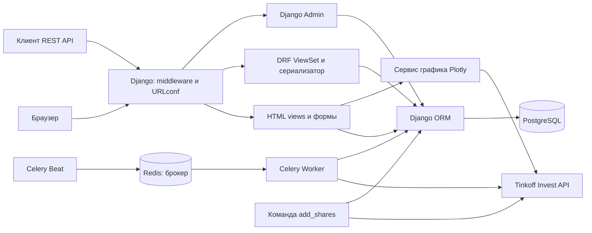

# Анализ исходного кода Investing Demo

Восстановленные функциональные требования, пользовательские сценарии и отдельный перечень неоднозначностей и дефектов приведены в [REQUIREMENTS.md](REQUIREMENTS.md).

## 1. Область анализа

Документ описывает текущую реализацию по исходному коду: моделям, миграциям, маршрутам, представлениям, формам, шаблонам, настройкам, задачам и тестам. Базовый коммит — `362510b` (`Add homework assignment`). Анализ выполнен статически: приложение, база данных, Celery и внешние API не запускались; успешное выполнение тестов и работоспособность интеграций не подтверждены. Исходный код приложения не изменялся.

## 2. Назначение и технологический стек

Приложение представляет собой учебный веб-каталог акций. Оно позволяет просматривать список инструментов и последнюю сохранённую цену, открывать график исторических котировок, регистрироваться и входить в систему. Авторизованный пользователь может добавлять, изменять и удалять записи общего каталога через HTML-интерфейс. Дополнительно реализованы REST API, административный интерфейс Django, импорт справочника акций и периодическое обновление цен.

Персональных портфелей, сделок, списков наблюдения, уведомлений и собственной таблицы истории цен в исходной реализации нет. График строится по данным внешнего сервиса, полученным при открытии страницы.

### Библиотеки и зависимости

Версии ниже взяты из [requirements.txt](requirements.txt), а не из установленного окружения.

| Технология | Версия | Назначение в проекте |
| --- | --- | --- |
| Python | Не зафиксирована | Язык приложения; отдельного ограничения версии в репозитории нет |
| Django | 4.1.7 | Маршрутизация, ORM, HTML-шаблоны, формы, сессии, аутентификация, администрирование |
| Django REST Framework | 3.14.0 | Сериализация и CRUD API акций |
| django-filter | 22.1 | Фильтрация REST-списка |
| PostgreSQL / psycopg2-binary | Образ без тега / 2.9.5 | Основное хранилище и Python-драйвер |
| Celery / redis | 5.2.7 / 4.5.1 | Фоновые задачи и клиент Redis; сервер Redis используется как брокер |
| tinkoff-investments | 0.2.0b50 | `tinkoff.invest.Client`: инструменты, последние цены и свечи |
| Plotly | 5.13.1 | Формирование HTML-графика котировок |
| django-crispy-forms / crispy-bootstrap3 | 2.0 / 2022.1 | Отображение полей формы акций |
| Black / isort | 23.1.0 / 5.12.0 | Форматирование Python и упорядочивание импортов |

В списке зависимостей также закреплены транспортные и вспомогательные пакеты: `grpcio`, `protobuf`, `kombu`, `amqp`, `billiard`, `vine`, `asgiref`, `sqlparse` и другие. Пакет `tinkoff==0.1.1` указан отдельно, но его самостоятельное использование в прикладном коде не обнаружено; используемый импорт — `tinkoff.invest`.

Внешние зависимости исполнения:

- PostgreSQL: база `investing`, подключение к `localhost:5432` в [config/settings.py](config/settings.py).
- Redis: брокер `redis://127.0.0.1:6379/0`; настройка кэша или хранилища результатов Celery отсутствует.
- Tinkoff Invest API: требует `TINKOFF_TOKEN`; используется для импорта, последних цен и исторических свечей.
- CDN в [базовом шаблоне](dashboard/templates/dashboard/base.html): Plotly.js, jQuery, Popper, Font Awesome, Moment.js и Tempus Dominus. Bootstrap CSS хранится локально в приложениях.

## 3. Структура и основные компоненты

| Путь | Ответственность |
| --- | --- |
| `manage.py` | Запуск команд Django |
| `config/settings.py` | База данных, приложения, middleware, шаблоны, логирование и Celery |
| `config/urls.py` | Подключение dashboard, пользовательских маршрутов и `/admin/` |
| `config/wsgi.py`, `config/asgi.py` | Точки входа серверов приложения |
| `config/celery.py` | Создание Celery-приложения, поиск задач и расписание Beat |
| `dashboard/models.py`, `migrations/` | Модель акции и семь миграций её схемы |
| `dashboard/views.py`, `forms.py`, `urls.py` | HTML-список, карточка и CRUD акций |
| `dashboard/api/v1/` | DRF ViewSet, сериализатор, фильтры и роутер версии API |
| `dashboard/services/` | Получение последней цены и построение графика |
| `dashboard/tasks.py` | Фоновое обновление цен акций |
| `dashboard/management/commands/add_shares.py` | Импорт инструментов из Tinkoff API |
| `dashboard/admin.py` | Регистрация акций в Django Admin, поля и поиск |
| `user/` | Формы и представления регистрации, входа и выхода |
| `dashboard/templates/`, `user/templates/` | Серверные HTML-шаблоны |
| `dashboard/static/`, `user/static/` | CSS и локальные ресурсы интерфейса |
| `dashboard/tests.py` | Десять тестов API и HTML-списка |
| `docker-compose.yml` | Контейнеры PostgreSQL и Redis |
| `README.md`, `HOMEWORK.md` | Краткие команды запуска и условия учебного задания |

## 4. Архитектура и взаимодействие компонентов

По организации исходного кода это монолитное Django-приложение с серверным HTML-интерфейсом и REST API. Оба интерфейса используют одну модель `Share` и одну PostgreSQL-базу. Celery Worker и Beat запускаются отдельными процессами, но используют код и настройки того же проекта. Отдельного клиентского SPA и собственного сервиса обработки рыночных данных нет.

Слой представления составляют Django views, шаблоны и DRF. Работа с хранилищем выполняется непосредственно через ORM из представлений, задачи и команды импорта. Функции интеграции с рыночными данными выделены в `dashboard/services/`, однако общего сервисного слоя для всех операций нет. Часть модулей импортирует токен и логгер напрямую из `config.settings`.

Долговременные данные каталога находятся в PostgreSQL. Redis передаёт задачи worker-процессу; он не является источником цен для веб-интерфейса. Запрос графика выполняется синхронно в HTTP-запросе, поэтому скорость и успешность открытия карточки зависят от внешнего API.

## 5. Модель данных

### Акция: `Share`

Источник: [dashboard/models.py](dashboard/models.py). Имя таблицы по стандартному соглашению Django — `dashboard_share`.

| Атрибут | Тип | Ограничения и назначение |
| --- | --- | --- |
| `id` | `BigAutoField` | Автоматический первичный ключ |
| `figi` | `CharField(255)` | Обязательный уникальный идентификатор инструмента |
| `isin` | `CharField(255)` | Обязательный ISIN; уникальность не задана |
| `name` | `CharField(255)` | Обязательное название компании |
| `ticker` | `CharField(10)` | Обязательный уникальный тикер |
| `currency` | `CharField(20)` | Обязательная валюта; перечисление допустимых значений не задано |
| `uid` | `CharField(255)` | Обязательный уникальный идентификатор; строка, а не `UUIDField` |
| `last_price` | `FloatField` | Последняя сохранённая цена; разрешены `NULL` и пустое поле формы |
| `is_trend_high` | `BooleanField` | Направление изменения цены; разрешён `NULL` |
| `updated_at` | `DateTimeField` | `auto_now=True`, разрешён `NULL`; обновление при сохранении модели |

Семь миграций последовательно создают акцию, добавляют уникальность FIGI и тикера, `uid`, цену и направление, уточняют подписи и добавляют `updated_at`. В текущей модели у `updated_at` есть `blank=True`, а в миграции `0007` этот параметр отсутствует: состояние модели и миграций слегка расходится в части валидации.

### Пользователи и служебные сущности

В [user/models.py](user/models.py) `User` — результат `get_user_model()`. Собственная пользовательская модель и `AUTH_USER_MODEL` не заданы, поэтому используется стандартный `django.contrib.auth.models.User` (`auth_user`): идентификатор, уникальный `username`, хеш пароля, email, имя и фамилия, признаки активности и прав, даты входа и регистрации.

Регистрация передаёт email одновременно как `username` и `email` в `create_user()`. Пароль сохраняется средствами Django как хеш. Проверка повторного email реализована формой; отдельное ограничение уникальности email в собственной модели отсутствует.

Пользователь связан с группами и разрешениями стандартными связями Django. Установлены также служебные приложения сессий, типов содержимого и журнала администратора. Сессии при текущих настройках используют стандартное хранилище Django в БД.

**Связей между `Share` и пользователем нет.** В прикладной модели отсутствуют `ForeignKey`, `ManyToManyField` и `OneToOneField`. Все пользователи работают с общими акциями; владельцы записей и персональные наборы инструментов не выделены. Исторические свечи и отдельные значения цен в БД не сохраняются.

## 6. Обработка пользовательских запросов

### Общий путь

HTTP-запрос поступает в Django через WSGI или ASGI. Middleware обрабатывает безопасность, сессии, общие HTTP-правила, CSRF, аутентификацию, сообщения и защиту от встраивания во фрейм. Корневой URLconf выбирает HTML-представление, API или Django Admin. Представление обращается к ORM либо внешнему сервису и возвращает HTML, данные API или перенаправление.

### HTML-интерфейс акций

Источники: [dashboard/urls.py](dashboard/urls.py), [dashboard/views.py](dashboard/views.py), [dashboard/forms.py](dashboard/forms.py).

| Маршрут | Обработка и доступ |
| --- | --- |
| `GET /` | `ShareListView`: публичный список по `name`, страницы по 100 записей, параметр `page` |
| `GET /<pk>` | `ShareDetailView`: публичная карточка, выборка `Share.objects.get(id=pk)`, внешний запрос свечей и график |
| `GET/POST /create` | `ShareCreateView`: форма добавления; требуется вход |
| `GET/POST /update/<pk>` | `ShareUpdateView`: форма изменения; требуется вход |
| `GET/POST /delete/<pk>` | `ShareDeleteView`: подтверждение и удаление; требуется вход |
| `/admin/` | Стандартный Django Admin с проверками доступа Django |

У перечисленных HTML-маршрутов акций, кроме корня, завершающий `/` в шаблонах маршрутов отсутствует. `IsUserAuthenticatedMixin` проверяет только `request.user.is_authenticated`; анонимного пользователя перенаправляет на главную. Проверки владения акцией или отдельных разрешений изменения здесь нет.

`ShareModelForm` использует `fields = "__all__"`: включает все редактируемые поля модели, в том числе `uid`, цену и направление. Автоматические поля `id` и `updated_at` не являются обычными полями редактирования формы. Django выполняет валидацию формы и модели, а generic views сохраняют или удаляют запись через ORM. После успешного изменения следует перенаправление на `/`. POST-формы содержат CSRF-токены.

Список показывает тикер, название, ISIN, цену и валюту. Цвет цены определяется `is_trend_high`: истинное значение даёт зелёный фон, остальные значения — красный. Кнопки изменения видны после входа. Карточка показывает сохранённую цену, `updated_at` и HTML-график.

### REST API

Цепочка подключения: `config/urls.py` → `dashboard/urls.py` → `dashboard/api/urls.py` → `dashboard/api/v1/urls.py` → `DefaultRouter` → `ShareViewSet`.

| Метод и путь | Операция |
| --- | --- |
| `GET /api/v1/shares/` | Список |
| `POST /api/v1/shares/` | Создание |
| `GET /api/v1/shares/<pk>/` | Получение одной акции |
| `PUT /api/v1/shares/<pk>/` | Полное обновление доступных полей |
| `PATCH /api/v1/shares/<pk>/` | Частичное обновление |
| `DELETE /api/v1/shares/<pk>/` | Удаление |

Поведение CRUD предоставляется `ModelViewSet`. `ShareSerializer` преобразует модель в данные ответа и валидирует входные значения. В него включены все атрибуты из таблицы модели, **кроме `uid`**; `id` и `updated_at` являются автоматическими полями только для чтения.

`ShareFilter` задаёт точную фильтрацию по `name` и `ticker`. `OrderingFilter` разрешает `ordering=name`, `ordering=ticker` и обратный порядок с `-`. `search_fields = ["$name"]` задаёт регистронезависимый поиск по регулярному выражению в названии, а не обычный поиск подстроки. Например: `/api/v1/shares/?ticker=AAPL&ordering=name&limit=20&offset=0`.

В настройках установлена `LimitOffsetPagination`: размер по умолчанию 100, параметры `limit` и `offset`, результат списка с `count`, `next`, `previous`, `results`. Отдельный максимальный лимит в проекте не задан.

В ViewSet и глобальных настройках отсутствуют ограничения `permission_classes` / `DEFAULT_PERMISSION_CLASSES`. При стандартных настройках DRF это оставляет API доступным анонимным клиентам, включая изменения. HTML-mixin на API не распространяется. Существующие тесты также отправляют запросы изменения без предварительного входа.

### Регистрация и сессии

Источники: [user/views.py](user/views.py), [user/forms.py](user/forms.py), [user/urls.py](user/urls.py), [config/urls.py](config/urls.py).

В корневом маршруте указан префикс `"user"` без `/`, а дочерние пути начинаются сразу с имени. Поэтому фактические адреса — **`/userlogin/`, `/userregistration/`, `/userlogout/`**, а не `/user/login/` и подобные. Шаблоны используют именованные маршруты и получают эти же адреса.

1. При регистрации `RegistrationForm` проверяет email, наличие паролей, их совпадение и существование пользователя с таким email. Затем `create_user(email, email, password)` создаёт пользователя, `authenticate()` получает его, а `login()` открывает сессию и перенаправляет на главную.
2. При входе `AuthView.post()` читает email и пароль из `form.data`, приводит email к нижнему регистру и вызывает `authenticate()`. При успехе открывает сессию; при отказе повторно показывает форму с сообщением.
3. `LogoutView.get()` вызывает `logout()` и перенаправляет на главную. Выход выполняется GET-запросом.

## 7. Работа с БД и рыночными данными

### ORM и хранение

Активный backend — PostgreSQL; блок SQLite закомментирован. В прикладном коде прямой SQL отсутствует. Используются `all()`, `get()`, `filter()`, `create_user()`, `get_or_create()` и `QuerySet.update()`, а также операции generic views и DRF. Уникальность `figi`, `ticker`, `uid` задаётся моделью и миграциями. Явных блоков `transaction.atomic()` и настройки `ATOMIC_REQUESTS` нет; многошаговые процессы импорта и обновления не объединены прикладным кодом в общую транзакцию.

### Первоначальная загрузка

Команда `python manage.py add_shares` открывает `Client(TINKOFF_TOKEN)`, вызывает `client.instruments.shares()` и перебирает инструменты. Для каждого вызывает `Share.objects.get_or_create()` с FIGI, названием, ISIN, тикером, валютой и UID. Цена при импорте не задаётся.

Поиск существующей записи ведётся сразу по всем переданным полям. Если инструмент с тем же уникальным FIGI уже есть, но его название или другой атрибут изменился, поиск не найдёт полного совпадения, а попытка создания может нарушить уникальность. Обновления справочных атрибутов существующей записи команда не выполняет.

### Обновление последних цен

Источники: [config/celery.py](config/celery.py), [dashboard/tasks.py](dashboard/tasks.py), [dashboard/services/market_data.py](dashboard/services/market_data.py).

1. Celery Beat публикует `dashboard.tasks.update_last_price` каждые **10 секунд** (`schedule = 10.0`), хотя ключ расписания назван `add-every-5-min`.
2. Worker выбирает все акции через `Share.objects.all()` и последовательно обходит их.
3. `get_last_data()` для каждой акции открывает клиент, запрашивает `get_last_prices(figi=[share.figi])` и возвращает `price.units` и время котировки.
4. Если прежняя цена выше новой, сохраняется `is_trend_high=False`; иначе — `True`, включая равенство цен. Ошибка сравнения, в частности при первоначальном `NULL`, логируется и также даёт `True`.
5. `Share.objects.filter(id=share.id).update(...)` записывает цену и направление. Ошибка обработки отдельной акции логируется; цикл переходит к следующей. Явные повторы задачи или защита от параллельных запусков отсутствуют.

Пишутся сообщения в консоль и `app.logs`. Время котировки возвращается в переменную `detetime`, но дальше не используется. `QuerySet.update()` не вызывает автоматическое обновление `auto_now`, поэтому `updated_at` не меняется при этой фоновой записи.

### Исторический график

[get_graph()](dashboard/services/graph.py) запрашивает дневные свечи от `now() - timedelta(days=180)` через `client.get_all_candles()`. По датам и `candle.close.units` строится линейный `Scatter`, затем `plot(..., output_type="div")` формирует HTML для карточки. Шаблон вставляет этот HTML с отключённым экранированием. Локального накопления свечей, кэша графика и выбора периода пользователем нет.

## 8. Ограничения, выявленные при чтении кода

Это наблюдения об исходной реализации, а не подтверждение ошибок в запущенном окружении.

| Наблюдение и источник | Следствие |
| --- | --- |
| Пустые `SECRET_KEY` и `TINKOFF_TOKEN`, `DEBUG=True` в `config/settings.py`; загрузки `.env` нет | Необходима локальная конфигурация; операции с ключом Django и рыночным API нельзя считать работоспособными без неё |
| В API не заданы ограничения доступа | Изменение общего каталога возможно без HTML-проверки входа |
| `uid` обязателен и уникален в модели, но отсутствует в `ShareSerializer` | API не может принять UID из запроса; повторное создание с неявным пустым строковым значением может нарушить уникальность. Наличие `uid` в тестовом JSON эту проблему не устраняет |
| В обоих рыночных сервисах используются только `.units` | Дробная часть котировки не учитывается; отображаемая и сохранённая цена может терять точность |
| `update_last_price()` не записывает `updated_at` и время котировки | Показанное время не отражает последнее фоновое обновление цены |
| Карточка вызывает `Share.objects.get()` и внешний API без обработки ошибок | Отсутствующая акция и сбой API могут привести к серверной ошибке вместо штатного ответа |
| В `RegistrationForm.clean()` используются прямые обращения к `cleaned_data`, а во view — к `form.errors["__all__"]` | Некорректные или отсутствующие поля могут вызвать `KeyError` при обработке регистрации |
| Вход не вызывает `form.is_valid()`; регистр email нормализуется только при входе; валидаторы пароля явно не вызываются формой регистрации | Валидация входа обходится, регистрация и вход могут расходиться по регистру email, настроенные проверки сложности пароля не применяются этой формой |
| В Docker Compose теги PostgreSQL/Redis не закреплены; каталог проекта смонтирован в `/app`, отдельного тома данных PostgreSQL нет | Версии инфраструктуры не воспроизводятся явно, хранение данных БД не управляется отдельным томом в конфигурации |

Docker Compose запускает только БД и брокер. Контейнеры Django, Worker и Beat в нём не описаны. Время Django настроено как UTC, Celery — `Europe/Moscow`; это следует учитывать при интерпретации дат.

## 9. Тесты и границы подтверждённости

В [dashboard/tests.py](dashboard/tests.py) находится класс `DashboardTests(APITestCase)` с десятью методами: HTML-список, REST-список, получение одной акции, создание, изменение и удаление, а также отрицательные сценарии 400/404. Данные создаются в `setUp()` через ORM.

Проверок регистрации и входа, доступа к HTML-изменениям, фильтрации, поиска, пагинации, фоновых задач, импорта и графика в репозитории нет. Процент покрытия не настроен. Для запуска предусмотрено `python manage.py test`; текущий отчёт основан на чтении тестов, без их выполнения. Условия доступности PostgreSQL, действительность токена и совместимость зависимостей требуют отдельной проверки запуска.
