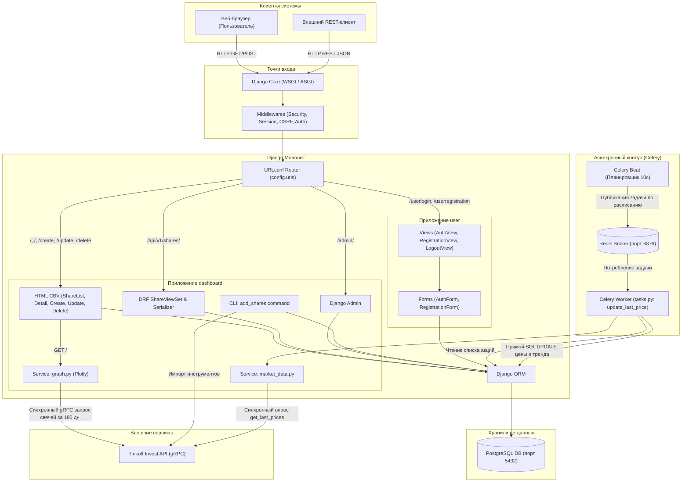

# Анализ исходного кода проекта Investing Demo (Агент Antigravity)

Данный документ содержит результаты комплексного аудита и анализа архитектуры, структуры, модели данных и механизмов взаимодействия компонентов исходного кода приложения **Investing Demo**. Анализ выполнен на базе исходного коммита репозитория (`362510b`).

Спецификация детально восстановленных функциональных требований, пользовательских сценариев и перечень дефектов приведены в документе [REQUIREMENTS.md](REQUIREMENTS.md).

---

## 1. Назначение приложения и используемый технологический стек

### 1.1. Бизнес-назначение
Приложение **Investing Demo** представляет собой учебный сервис мониторинга финансовых инструментов (акций фондового рынка). 
Основной функционал приложения включает:
- Просмотр общего каталога акций с отображением актуальных котировок, валюты и цветовой индикации тренда цены (рост/падение).
- Просмотр детальной карточки акции с построением интерактивного исторического графика котировок (за последние 180 дней).
- Регистрацию и аутентификацию пользователей.
- Управление каталогом акций через веб-интерфейс (добавление, редактирование, удаление инструментов — доступно авторизованным пользователям).
- Программный доступ через REST API (CRUD-операции, фильтрация, сортировка, поиск, пагинация).
- Пакетную первоначальную загрузку каталога акций через интеграцию с внешним брокерским API.
- Фоновый периодический сбор и обновление рыночных цен акций.

### 1.2. Технологический стек
| Уровень / Компонент | Технология | Версия (requirements.txt) | Назначение |
|---|---|---|---|
| **Язык разработки** | Python | 3.10–3.11 (в коде не зафиксирована) | Основной язык реализации backend |
| **Web-фреймворк** | Django | 4.1.7 | Архитектура MTV, маршрутизация, ORM, аутентификация, шаблонизация, сессии, админ-панель |
| **REST API** | Django REST Framework (DRF) | 3.14.0 | Реализация сериализаторов, ViewSet, REST API эндпоинтов |
| **Фильтрация API** | django-filter | 22.1 | Декларативная фильтрация запросов в DRF |
| **База данных** | PostgreSQL | 15 / Latest (в docker-compose) | Реляционная СУБД для хранения данных приложения |
| **Драйвер БД** | psycopg2-binary | 2.9.5 | Коннектор Python к PostgreSQL |
| **Асинхронные задачи** | Celery | 5.2.7 | Очередь и планировщик фоновых периодических задач |
| **Брокер сообщений** | Redis | 7 / Latest (в docker-compose) / redis-py 4.5.1 | Транспорт сообщений и брокер очередей для Celery |
| **Внешняя интеграция** | Tinkoff Invest API (`tinkoff-investments`) | 0.2.0b50 (gRPC / protobuf 3.20.3) | Получение рыночных котировок, исторических свечей и справочников ценных бумаг |
| **Визуализация данных** | Plotly | 5.13.1 | Построение интерактивных графиков котировок (генерация HTML div) |
| **Формы и UI** | django-crispy-forms / crispy-bootstrap3 | 2.0 / 2022.1 | Рендеринг форм Django в стиле Bootstrap |
| **Frontend-библиотеки** | Bootstrap 3/4, jQuery, Popper.js, Font Awesome, Moment.js, Tempus Dominus | CDN / локальные статические файлы | Клиентский интерфейс и верстка страниц |
| **Инфраструктура** | Docker & Docker Compose | Compose file v3 | Локальное развертывание сервисов БД (PostgreSQL) и брокера (Redis) |
| **Линтеры и утилиты** | Black, isort | 23.1.0 / 5.12.0 | Форматирование исходного кода |

---

## 2. Структура проекта и назначение компонентов

Проект организован по модульному принципу Django-монолита и включает два основных функциональных приложения (`dashboard` и `user`) и пакет общесистемной конфигурации (`config`).

```
.
├── config/                     # Общесистемная конфигурация проекта
│   ├── __init__.py             # Инициализация Celery-приложения при старте Django
│   ├── asgi.py                 # Точка входа для ASGI-серверов
│   ├── celery.py               # Конфигурация экземпляра Celery и расписания Beat
│   ├── settings.py             # Глобальные настройки Django, БД, Celery, логгеров, токенов
│   ├── urls.py                 # Корневой маршрутизатор URL проекта
│   └── wsgi.py                 # Точка входа для WSGI-серверов
├── dashboard/                  # Основное приложение: каталог акций и аналитика
│   ├── admin.py                # Регистрация модели Share в панели администратора Django
│   ├── api/                    # Слой программного REST API
│   │   ├── urls.py             # Подключение версий API (/api/v1/)
│   │   └── v1/
│   │       ├── router.py       # DRF DefaultRouter для ViewSet акций
│   │       ├── serializer.py   # Сериализатор ShareSerializer
│   │       ├── urls.py         # URLconf для v1 API
│   │       └── views.py        # ShareViewSet и фильтр ShareFilter
│   ├── apps.py                 # Конфигурация приложения DashboardConfig
│   ├── forms.py                # ShareModelForm для управления акциями через веб-форму
│   ├── management/
│   │   └── commands/
│   │       └── add_shares.py   # CLI-команда импорта инструментов из Tinkoff API в БД
│   ├── migrations/             # 7 миграций структуры таблицы Share (dashboard_share)
│   ├── models.py               # Описание модели Share (акция)
│   ├── services/               # Интеграционный сервисный слой
│   │   ├── graph.py            # Построение графика котировок через Tinkoff API + Plotly
│   │   └── market_data.py      # Получение текущих котировок инструмента через Tinkoff API
│   ├── static/dashboard/       # Локальные CSS-стили интерфейса
│   ├── tasks.py                # Периодическая Celery-задача обновления цен update_last_price
│   ├── templates/dashboard/    # HTML-шаблоны (base, list, detail, create, delete)
│   ├── tests.py                # Модульные и интеграционные тесты API и представлений
│   ├── urls.py                 # URLconf маршрутов веб-интерфейса и API акций
│   └── views.py                # Представления (CBV): ShareListView, Detail, Create, Update, Delete
├── user/                       # Приложение управления пользователями и аутентификацией
│   ├── apps.py                 # Конфигурация приложения UserConfig
│   ├── forms.py                # Формы RegistrationForm и AuthForm
│   ├── models.py               # Ссылка на базовую модель User (django.contrib.auth)
│   ├── static/user/            # CSS-стили страниц авторизации
│   ├── templates/user/         # Шаблоны входа, регистрации и базовый шаблон пользователя
│   ├── urls.py                 # Маршруты auth (login, registration, logout)
│   └── views.py                # Представления: AuthView, RegistrationView, LogoutView
├── docker-compose.yml          # Запуск контейнеров PostgreSQL и Redis
├── manage.py                   # Точка входа для CLI-команд управления Django
├── requirements.txt            # Список зависимостей Python
└── README.md                   # Краткая инструкция по локальному запуску
```

---

## 3. Архитектура приложения и взаимодействие компонентов

### 3.1. Архитектурный стиль
Приложение спроектировано как **модульный монолит** с трехуровневой архитектурой (Presentation, Business Logic / Services, Data Access) и выделенным асинхронным контуром фоновой обработки данных.

В приложении сосуществуют два канала взаимодействия с пользователями:
1. **Server-Side Rendered (SSR) Web UI** — стандартный MVC/MTV подход Django с использованием HTML-шаблонов, Django Forms и Class-Based Views.
2. **REST API** — программный JSON-интерфейс на базе Django REST Framework для интеграции внешних клиентов.

### 3.2. Схема взаимодействия компонентов



### 3.3. Ключевые сценарии взаимодействия
1. **Просмотр карточки акции и котировок**:
   - Клиент отправляет `GET /<pk>`.
   - `ShareDetailView` запрашивает запись акции через `Share.objects.get(id=pk)`.
   - Представление вызывает сервис `get_graph(share)`: открывается клиент `Client(TINKOFF_TOKEN)` и по gRPC запрашиваются дневные исторические свечи за 180 дней.
   - Plotly генерирует HTML-фрагмент графика (`plot_div`), который передается в шаблон `detail.html` и отображается пользователю.
2. **Фоновое обновление котировок**:
   - Планировщик `Celery Beat` с интервалом 10 секунд ставит в очередь Redis задачу `dashboard.tasks.update_last_price`.
   - `Celery Worker` забирает задачу, извлекает все акции из PostgreSQL через `Share.objects.all()`.
   - Для каждой акции вызывается `get_last_data(share)`: выполняется отдельный сетевой gRPC-запрос к Tinkoff API, получается последняя цена.
   - Рассчитывается флаг роста цены `is_trend_high` относительно старой цены.
   - Выполняется обновление записи в БД через `Share.objects.filter(id=share.id).update(...)`.

---

## 4. Используемые библиотеки и внешние зависимости

### 4.1. Анализ ключевых зависимостей из requirements.txt
- **Django 4.1.7**: ядро веб-приложения (ORM, маршрутизация, движок шаблонов, управление сессиями, CSRF-защита, встроенная админка).
- **djangorestframework 3.14.0** и **django-filter 22.1**: реализация CRUD API для акций с пагинацией (`LimitOffsetPagination`, размер 100), фильтрацией по точным совпадениям (`name`, `ticker`), сортировкой (`OrderingFilter`) и регулярным поиском (`SearchFilter`).
- **celery 5.2.7**, **redis 4.5.1**, **kombu 5.2.4**, **amqp 5.1.1**, **billiard 3.6.4.0**, **vine 5.0.0**: подсистема асинхронной очереди задач и взаимодействия с брокером Redis.
- **tinkoff-investments 0.2.0b50**, **grpcio 1.51.3**, **protobuf 3.20.3**: официальный SDK Tinkoff Invest API (OpenAPI v2), работающий по протоколу gRPC. В файле зависимостей также присутствует пустой/устаревший пакет `tinkoff==0.1.1`, который непосредственно в коде не вызывается.
- **plotly 5.13.1**: библиотека генерации векторных интерактивных графиков, формирующая автономный HTML `<div>` для вставки в шаблон.
- **django-crispy-forms 2.0** и **crispy-bootstrap3 2022.1**: рендеринг полей Django-форм в разметку Bootstrap.
- **psycopg2-binary 2.9.5**: бинарный C-адаптер для взаимодействия Django ORM с СУБД PostgreSQL.
- **pydantic 1.10.6**, **python-dateutil 2.8.2**, **pytz 2022.7.1**: вспомогательные пакеты работы со схемами данных, таймзонами и датами.
- **black 23.1.0**, **isort 5.12.0**: инструменты статического анализа и автоформатирования кода.

### 4.2. Внешние runtime-зависимости
1. **СУБД PostgreSQL**:
   - База данных `investing`, пользователь `postgres`, порт `5432`.
   - Запускается через `docker-compose.yml`.
2. **Брокер очередей Redis**:
   - Сервер `redis://127.0.0.1:6379/0`.
   - Запускается через `docker-compose.yml`.
3. **Внешний API Tinkoff Investments**:
   - Требует валидный токен авторизации (`TINKOFF_TOKEN`).
   - Используется для загрузки инструментов, получения свечей и котировок.
4. **Внешние CDN-ресурсы (клиентские зависимости в base.html)**:
   - `cdn.plot.ly/plotly-latest.min.js`
   - `code.jquery.com/jquery-3.3.1.slim.min.js`
   - `cdnjs.cloudflare.com/ajax/libs/popper.js/1.14.6/umd/popper.min.js`
   - `stackpath.bootstrapcdn.com/font-awesome/4.7.0/css/font-awesome.min.css`
   - `cdnjs.cloudflare.com/ajax/libs/moment.js/2.23.0/moment.min.js`
   - `cdnjs.cloudflare.com/ajax/libs/tempusdominus-bootstrap-4/5.1.2/`

---

## 5. Модель данных: сущности, атрибуты и связи

### 5.1. Сущность `Share` (Акция)
Определена в `dashboard/models.py`. Соответствует таблице `dashboard_share` в базе данных PostgreSQL.

| Поле | Django-тип | Ограничения и параметры | Назначение |
|---|---|---|---|
| `id` | `BigAutoField` | `primary_key=True`, `auto_created=True` | Уникальный суррогатный идентификатор записи |
| `figi` | `CharField(max_length=255)` | `unique=True`, `null=False` | Международный идентификатор финансового инструмента (FIGI) |
| `isin` | `CharField(max_length=255)` | `null=False` | Международный идентификационный код ценной бумаги (ISIN) |
| `name` | `CharField(max_length=255)` | `null=False`, `verbose_name="Наименование компании"` | Наименование компании/эмитента |
| `ticker` | `CharField(max_length=10)` | `unique=True`, `null=False`, `verbose_name="Тикер"` | Биржевой тикер ценной бумаги (краткий символ) |
| `currency` | `CharField(max_length=20)` | `null=False`, `verbose_name="Валюта"` | Код или наименование валюты котировки |
| `uid` | `CharField(max_length=255)` | `unique=True`, `null=False` | Внутренний уникальный идентификатор инструмента в Tinkoff API |
| `last_price` | `FloatField` | `null=True`, `blank=True`, `verbose_name="Текущая цена"` | Последняя зафиксированная цена акции |
| `is_trend_high` | `BooleanField` | `null=True`, `blank=True`, `verbose_name="Растет цена"` | Признак положительного ценового тренда (True — рост/равенство, False — падение) |
| `updated_at` | `DateTimeField` | `auto_now=True`, `null=True`, `blank=True` | Временная метка последнего сохранения записи в БД |

#### История миграций модели `Share`:
1. `0001_add_share` — первоначальное создание таблицы с полями `figi`, `isin`, `name`, `ticker`, `currency`.
2. `0002_update_share` — добавление ограничений уникальности `unique=True` на `figi` и `ticker`.
3. `0003_add_uuid` — добавление уникального строкового поля `uid`.
4. `0004_add_last_price` — добавление полей `last_price` (`FloatField`) и `is_trend_high` (`BooleanField`).
5. `0005_add_verbose_name` — уточнение человекочитаемых имен (`verbose_name`) полей.
6. `0006_add_verbose_name` — добавление `verbose_name` для поля `ticker`.
7. `0007_add_updated_at` — добавление поля `updated_at` (`DateTimeField`, `auto_now=True`).

### 5.2. Сущность `User` (Пользователь)
В `user/models.py` используется стандартная модель Django User (`get_user_model()`), представляющая таблицу `auth_user`:
- `id` (`BigAutoField`, PK)
- `username` (`CharField(150)`, unique) — при регистрации заполняется значением адреса электронной почты.
- `email` (`EmailField`) — адрес электронной почты.
- `password` (`CharField(128)`) — зашифрованный хеш пароля (PBKDF2/SHA256).
- `is_active`, `is_staff`, `is_superuser`, `date_joined`, `last_login`.

### 5.3. Анализ связей между сущностями
- **Связи между сущностями отсутствуют полностью.** В моделях приложения нет ни одного внешнего ключа (`ForeignKey`, `ManyToManyField`, `OneToOneField`).
- Каталог акций является **глобальным и общедоступным**: акции не привязаны к создателям или владельцам.
- В текущей архитектуре **отсутствуют**:
  - Сущности инвестиционных портфелей (`Portfolio`) и позиций портфеля (`Position`).
  - Сущности транзакций покупки/продажи (`Transaction` / `Trade`).
  - Сущности персональных списков отслеживания / мониторинга (`Watchlist` / `Alert`).
  - Таблицы хранения исторических котировок и свечей (`PriceHistory` / `Candle`). Все исторические данные запрашиваются исключительно "на лету" из стороннего API.

---

## 6. Механизмы обработки пользовательских запросов и взаимодействия с БД

### 6.1. Жизненный цикл HTTP-запросов и маршрутизация
Входящий запрос от клиента (браузера или API-клиента) проходит стандартный стек Django:
1. **WSGI/ASGI Handler** принимает сокетное соединение и формирует объект `HttpRequest`.
2. **Middleware Stack**:
   - `SecurityMiddleware`: базовая безопасность заголовков.
   - `SessionMiddleware`: извлечение сессии из куки и загрузка данных сессии из БД (`django_session`).
   - `CommonMiddleware`: обработка URL (trailing slash и т.д.).
   - `CsrfViewMiddleware`: валидация CSRF-токена для POST/PUT/DELETE запросов.
   - `AuthenticationMiddleware`: ассоциирование пользователя `request.user` на основе ID сессии.
   - `MessageMiddleware` и `XFrameOptionsMiddleware`.
3. **Диспетчеризация URL** (`ROOT_URLCONF = "config.urls"`):
   - `/admin/` -> стандартный `django.contrib.admin`.
   - `""` -> `dashboard.urls` (веб-интерфейс и API).
   - `"user"` -> `user.urls` (авторизация и регистрация). *Обратите внимание: из-за отсутствия слэша формируются адреса `/userlogin/`, `/userregistration/`, `/userlogout/`.*

### 6.2. Обработка запросов веб-интерфейса (HTML Views)
- **`ShareListView` (`GET /`)**:
  - Наследуется от `ListView`.
  - Выполняет ORM-запрос `Share.objects.all().order_by("name")`.
  - Применяет пагинацию по 100 элементов (`paginate_by = 100`).
  - Рендерит шаблон `dashboard/list.html`.
  - Доступ: открыт для всех посетителей.
- **`ShareDetailView` (`GET /<int:pk>`)**:
  - Наследуется от базового `View`.
  - Выполняет запрос `Share.objects.get(id=pk)`.
  - Синхронно вызывает внешний сервис `get_graph(share)`, запрашивающий свечи из Tinkoff API и формирующий HTML div графика Plotly.
  - Рендерит шаблон `dashboard/detail.html`.
  - Доступ: открыт для всех посетителей.
- **`ShareCreateView` (`GET/POST /create`)**:
  - Наследуется от `CreateView` с миксином `IsUserAuthenticatedMixin`.
  - Если пользователь не аутентифицирован, миксин перенаправляет его на `dashboard:index`.
  - Валидирует `ShareModelForm`.
  - При успешном POST сохраняет новую запись через `form.save()` (ORM `Share.objects.create(...)`) и перенаправляет на главную страницу.
- **`ShareUpdateView` (`GET/POST /update/<int:pk>`)**:
  - Наследуется от `UpdateView` с миксином `IsUserAuthenticatedMixin`.
  - Позволяет изменить атрибуты существующей акции.
- **`ShareDeleteView` (`GET/POST /delete/<int:pk>`)**:
  - Наследуется от `DeleteView` с миксином `IsUserAuthenticatedMixin`.
  - При GET отображает страницу подтверждения удаления `dashboard/delete.html`.
  - При POST удаляет запись из базы (`share.delete()`).

### 6.3. Обработка запросов через REST API (DRF)
- Роутинг API: `/api/v1/shares/` зарегистрирован в `DefaultRouter`.
- **`ShareViewSet` (`ModelViewSet`)**:
  - Предоставляет стандартные операции CRUD:
    - `GET /api/v1/shares/` — список акций с пагинацией `LimitOffsetPagination`.
    - `POST /api/v1/shares/` — создание акции.
    - `GET /api/v1/shares/{id}/` — детальная информация об акции.
    - `PUT /api/v1/shares/{id}/` — полное обновление акции.
    - `PATCH /api/v1/shares/{id}/` — частичное обновление.
    - `DELETE /api/v1/shares/{id}/` — удаление акции.
  - **Сериализация**: `ShareSerializer` сериализует поля: `id`, `figi`, `isin`, `name`, `ticker`, `currency`, `last_price`, `is_trend_high`, `updated_at`.
  - **Фильтрация и поиск**:
    - `DjangoFilterBackend`: точная фильтрация по полям `name` и `ticker`.
    - `OrderingFilter`: сортировка по полям `name` и `ticker` (`?ordering=-name`).
    - `SearchFilter`: поиск по названию `search_fields = ["$name"]` (регистронезависимое регулярное выражение DRF).
  - **Безопасность API**: в `ShareViewSet` **отсутствуют `permission_classes`**! В отличие от HTML-интерфейса, все CRUD-операции API (включая удаление и изменение) открыты для неавторизованных анонимных пользователей.

### 6.4. Механизм авторизации и регистрации (`user`)
- **`RegistrationView` (`GET/POST /userregistration/`)**:
  - Форма `RegistrationForm` принимает `email`, `password1`, `password2`.
  - Проверяет совпадение паролей и уникальность email через `User.objects.filter(email=email)`.
  - Метод `save()` создает пользователя вызовом `User.objects.create_user(email, email, password)`.
  - Вызывает `login(request, user)` и выполняет редирект на главную страницу.
- **`AuthView` (`GET/POST /userlogin/`)**:
  - Читает `email` и `password` напрямую из `request.POST`.
  - Вызывает Django `authenticate(username=email.lower(), password=password)`.
  - При успехе создает сессию через `login(request, user)`.
- **`LogoutView` (`GET /userlogout/`)**:
  - Завершает сессию через `logout(request)`.

### 6.5. Взаимодействие с базой данных и транзакционность
- Все операции чтения и записи производятся через **Django ORM** поверх драйвера `psycopg2-binary`. Прямой SQL отсутствует.
- Режим `ATOMIC_REQUESTS` выключен (по умолчанию в Django `False`), явные блоки `transaction.atomic()` в прикладном коде не используются.
- В фоновой задаче `update_last_price` обновление выполняется через `Share.objects.filter(id=share.id).update(...)`. Это транслируется в прямой SQL `UPDATE dashboard_share SET last_price=..., is_trend_high=... WHERE id=...`, минуя вызов метода `save()` модели Django.

---

## 7. Выявленные архитектурные недостатки, дефекты и риски

В ходе детального исследования кодовой базы был выявлен ряд существенных дефектов и спорных архитектурных решений:

1. **Безопасность и конфигурация**:
   - `config/settings.py`: жестко прописаны пустые строки `SECRET_KEY = ""` и `TINKOFF_TOKEN = ""`, включен `DEBUG = True`, `ALLOWED_HOSTS = []`. Отсутствует механизм загрузки переменных окружения (через `python-dotenv` или аналоги).
   - В `ShareViewSet` не заданы классы разрешений (`permission_classes`). Любой анонимный клиент может создать, изменить или удалить любые акции через REST API.
   - Выход из системы (`LogoutView`) реализован через `GET`-запрос, что нарушает стандарты веб-безопасности (уязвимость к CSRF/префетчу ссылок).

2. **Несогласованность модели данных и API**:
   - Поле `uid` в модели `Share` является обязательным и уникальным (`unique=True`), однако в `ShareSerializer` поле `uid` не включено в список `fields`. При попытке создания акций через API валидация DRF не требует и не заполняет `uid`, что приведет к ошибкам нарушения уникальности пустых значений в БД при попытке создать более одной акции.
   - Использование `FloatField` для денежных величин (`last_price`) чревато потерей точности вычислений из-за особенностей представления чисел с плавающей точкой в стандарте IEEE 754 (необходимо использовать `DecimalField`).

3. **Интеграция с рыночными данными (Tinkoff Invest API)**:
   - В сервисах `dashboard/services/market_data.py` (`resp.price.units`) и `dashboard/services/graph.py` (`candle.close.units`) используется исключительно атрибут `units` объекта цены. Дробная составляющая копейки/центы (`nano`) игнорируется, из-за чего цены отображаются с потерей дробной части.
   - Синхронный сетевой gRPC-вызов при открытии карточки акции (`ShareDetailView` -> `get_graph`): при задержках или сбоях во внешнем API страница зависает или возвращает ошибку 500. Отсутствует кэширование и асинхронное получение данных.
   - В фоновой задаче `update_last_price` (`dashboard/tasks.py`) на каждую акцию в цикле создается отдельный экземпляр `Client(TINKOFF_TOKEN)` и выполняется отдельный сетевой запрос `get_last_prices(figi=[share.figi])`. Для N акций это порождает N сетевых соединений (проблема N+1) вместо одного пакетного запроса по списку FIGI.
   - В задаче `tasks.py` переменная времени котировки названа с опечаткой `detetime` и не используется.

4. **Ошибки в механизмах представления и формах**:
   - Маршрутизация в `config/urls.py`: `path("user", include("user.urls"))` без завершающего слэша создает некорректные URI-пути (`/userlogin/` вместо `/user/login/`).
   - `user/forms.py`: В `RegistrationForm.clean()` происходит прямое обращение к `self.cleaned_data["email"]`, `password1`, `password2` без проверки их наличия. Если поле не прошло базовую валидацию, вызывается необработанное исключение `KeyError`.
   - `user/views.py`: В `RegistrationView.post()` в блоке `else` выполняется попытка извлечения `form.errors["__all__"].data[0].message`. Если ошибка валидации возникла в конкретном поле (например, невалидный формат email), ключ `"__all__"` отсутствует, что приводит к падению сервера с ошибкой `KeyError: '__all__'`.
   - `AuthView.post()` не вызывает метод `form.is_valid()`, обращаясь к `form.data` напрямую.
   - Регистрация сохраняет email как есть, а авторизация выполняет `.lower()`, что может вызвать проблемы со входом при использовании заглавных букв в email.

5. **Ошибки обновления метаданных**:
   - `Share.objects.filter(id=share.id).update(...)` в `tasks.py` не обновляет поле `updated_at`, так как метод `QuerySet.update()` не вызывает сигналы и не обрабатывает параметр `auto_now=True`. В результате пользователи видят некорректное время обновления котировки.
   - В `config/celery.py` задача названа `"add-every-5-min"`, но интервал запуска составляет `10.0` секунд.

---

## 8. Выводы

Исходный проект представляет собой учебный прототип веб-сервиса на стеке Django, Celery, PostgreSQL и Tinkoff Invest API. 
Приложение реализует базовые возможности просмотра каталога акций, серверного рендеринга графиков и периодического фонового обновления данных.

При этом в проекте:
- Полностью отсутствуют бизнес-сущности персональных портфелей, сделок, мониторинга цен и истории котировок в БД (что предстоит реализовать в последующих заданиях).
- Присутствует ряд критических дефектов надежности, безопасности, валидации форм и интеграции с внешними сервисами, требующих рефакторинга и модернизации.
- Кодовая база требует перехода на современные стандарты конфигурирования (12-Factor App, `.env`), исправления архитектурных недочетов в ORM и REST API, а также расширения тестового покрытия.
