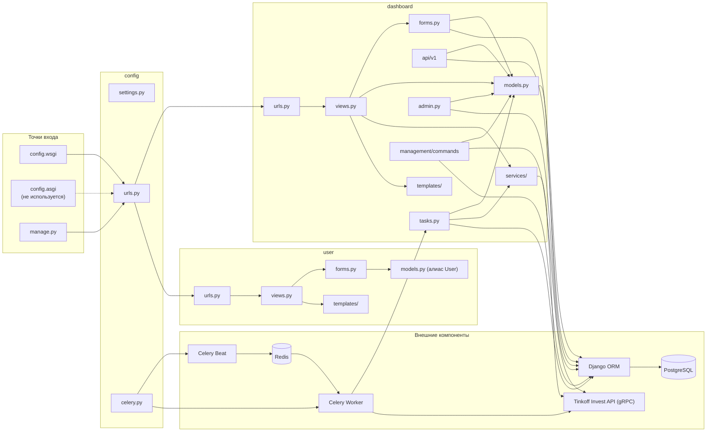
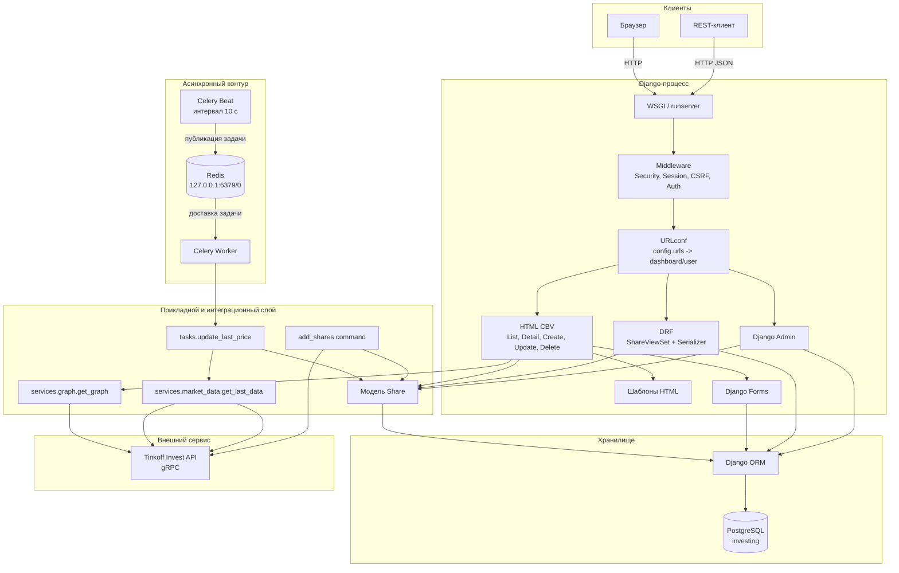
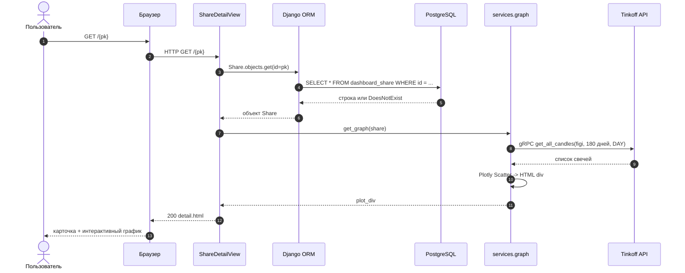
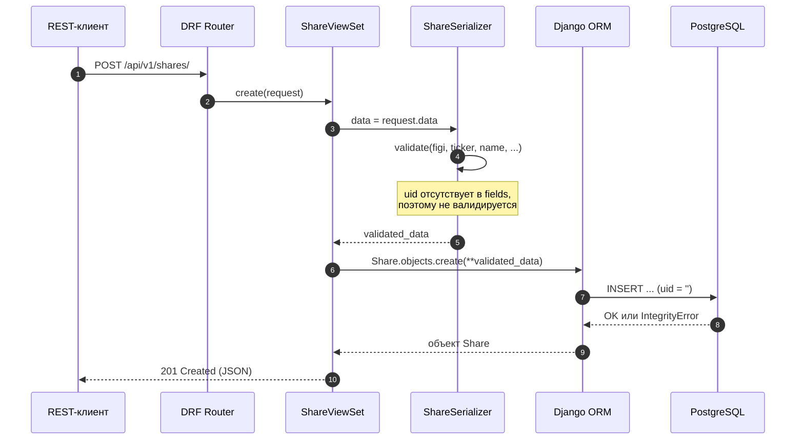
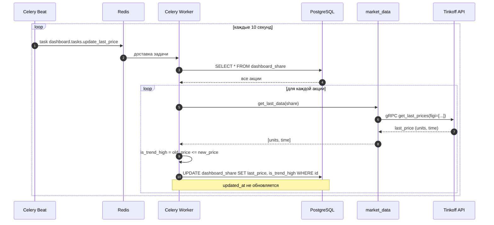
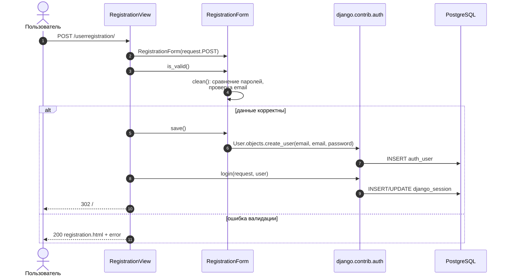
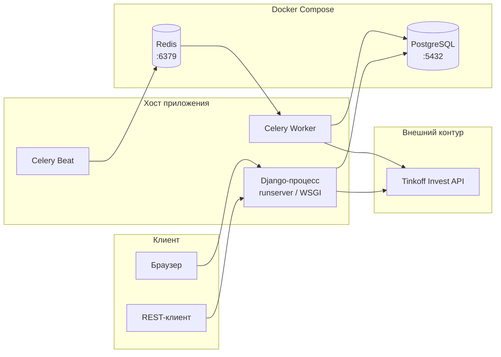
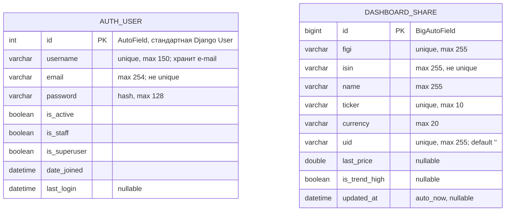
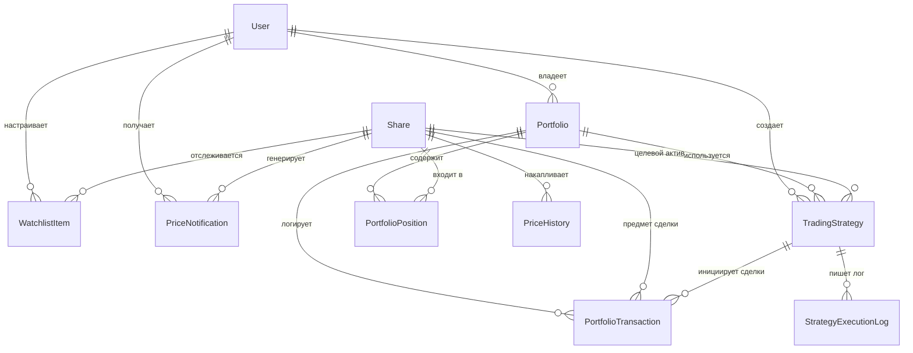

# Анализ исходного кода проекта Investing Demo

> **Домашнее задание №3, задание №1.** Анализ исходного кода, архитектуры, компонентов,
> зависимостей, модели данных и механизмов обработки запросов.
>
> **Объект анализа:** учебный веб-сервис **Investing Demo** (Django-проект `config`,
> приложения `dashboard` и `user`).
>
> **Базовая версия исходного кода:** коммит `362510b` (`Add homework assignment`),
> в котором исходный код проекта находится в первоначальном виде. Документ подготовлен
> в ветке `antigravity`.
>
> **Метод:** статический анализ всех отслеживаемых Git-файлов; точечная проверка
> URL-маршрутов через `django.urls.resolve()`/`reverse()` и метаданных моделей, форм и
> сериализатора через Django shell. Внешние вызовы Tinkoff Invest API, миграции и
> нагрузочные сценарии в рамках анализа не выполнялись. Локальные артефакты
> (`.venv/`, `db.sqlite3`, `.env`, `__pycache__/`, `app.logs`) не входят в исходный код
> и при анализе архитектуры не учитывались.

Спецификация детально восстановленных функциональных требований, пользовательских
сценариев и перечень дефектов приведены в документе [REQUIREMENTS.md](REQUIREMENTS.md).

---

## 1. Назначение приложения и технологический стек

### 1.1. Назначение

**Investing Demo** — учебное серверное веб-приложение для мониторинга акций
российского фондового рынка. Приложение получает справочник инструментов и рыночные
данные из **Tinkoff Invest API**, хранит каталог акций в реляционной БД и предоставляет
два канала работы:

1. **Server-Side Rendered (SSR) веб-интерфейс** — HTML-страницы каталога, карточки
   акции с графиком, формы добавления/редактирования/удаления, регистрация и вход.
2. **REST API** — JSON CRUD-интерфейс над каталогом акций с фильтрацией, сортировкой,
   поиском и пагинацией.

Дополнительно реализованы:

- разовая CLI-команда импорта справочника акций из Tinkoff API;
- фоновое периодическое обновление последних цен и признака роста через
  Celery Beat + Celery Worker + Redis;
- стандартная админ-панель Django для модели `Share`.

Приложение **не является** брокерским терминалом: оно не совершает сделок, не хранит
портфели, сделки, списки наблюдения, уведомления или историю котировок. Каталог акций
является глобальным: акции не принадлежат пользователям. Это важно для последующих
заданий — перечисленные сущности потребуется спроектировать и добавить.

### 1.2. Фактически реализованные возможности

| № | Возможность | Реализация | Ограничения |
|---|---|---|---|
| 1 | Каталог акций | `ShareListView` (`dashboard/views.py:20-26`), шаблон `list.html` | Только сортировка по `name`, пагинация по 100; поиска и фильтров в HTML нет |
| 2 | Карточка акции | `ShareDetailView` (`dashboard/views.py:29-38`), `detail.html` | Нет проверки существования записи; график запрашивается синхронно |
| 3 | График за 180 дней | `dashboard/services/graph.py:11-36`, Plotly | Только дневные свечи; учитываются только целые единицы цены |
| 4 | Добавление акции через сайт | `ShareCreateView`, `ShareModelForm` | Только для аутентифицированных; обязателен `uid` |
| 5 | Редактирование акции через сайт | `ShareUpdateView` | Только для аутентифицированных |
| 6 | Удаление акции через сайт | `ShareDeleteView` | Только для аутентифицированных; подтверждение через GET-страницу |
| 7 | REST CRUD акций | `ShareViewSet` (`dashboard/api/v1/views.py:16-22`) | Нет ограничений доступа; `uid` не сериализуется |
| 8 | Фильтрация, сортировка, поиск, пагинация API | `ShareFilter`, `OrderingFilter`, `SearchFilter`, `LimitOffsetPagination` | Поиск — по префиксу `name`; фильтр — точные `name`/`ticker` |
| 9 | Регистрация | `RegistrationView`, `RegistrationForm` | Парольные валидаторы Django не применяются; ошибки полей могут давать 500 |
| 10 | Вход/выход | `AuthView`, `LogoutView` | Вход по e-mail как по `username`; выход через GET |
| 11 | Импорт справочника акций | `manage.py add_shares` | Разовая команда; не обновляет существующие записи |
| 12 | Фоновое обновление цен | `dashboard/tasks.py:7-28`, Celery Beat | Интервал 10 секунд; последовательные запросы по каждой акции |
| 13 | Админ-панель | `ShareAdmin` (`dashboard/admin.py:6-19`) | Только стандартный CRUD модели `Share` |

### 1.3. Технологический стек

| Уровень | Технология | Версия в проекте | Назначение и подтверждение |
|---|---|---|---|
| Язык | Python | Не зафиксирована | Backend; `requirements.txt` не содержит ограничения версии Python |
| Web-фреймворк | Django | `4.1.7` | MTV, ORM, URLconf, шаблоны, сессии, CSRF, admin (`requirements.txt:13`) |
| REST API | Django REST Framework | `3.14.0` | `ModelViewSet`, сериализаторы, пагинация (`requirements.txt:16`) |
| Фильтрация API | django-filter | `22.1` | `DjangoFilterBackend`, `FilterSet` (`requirements.txt:15`) |
| Формы UI | django-crispy-forms | `2.0` | Рендеринг форм в шаблонах (`requirements.txt:14`) |
| Пакет crispy | crispy-bootstrap3 | `2022.1` | `CRISPY_TEMPLATE_PACK = "bootstrap3"` (`requirements.txt:12`, `config/settings.py:28-29`) |
| База данных | PostgreSQL | Образ `postgres` без тега (фактически `latest`) | Основное хранилище (`docker-compose.yml:3-14`); драйвер `psycopg2-binary==2.9.5` |
| Драйвер БД | psycopg2-binary | `2.9.5` | Адаптер PostgreSQL для Django ORM (`requirements.txt:27`) |
| Асинхронные задачи | Celery | `5.2.7` | Очередь задач, Beat-расписание (`requirements.txt:7`) |
| Брокер | Redis | Образ `redis` без тега (фактически `latest`); клиент `redis==4.5.1` | Транспорт Celery (`docker-compose.yml:16-19`, `requirements.txt:31`) |
| Внешний API | tinkoff-investments | `0.2.0b50` | gRPC-клиент Tinkoff Invest API (`requirements.txt:36`) |
| gRPC/protobuf | grpcio / protobuf | `1.51.3` / `3.20.3` | Транспорт и сериализация Tinkoff SDK (`requirements.txt:17,26`) |
| Визуализация | Plotly | `5.13.1` | Генерация HTML-фрагмента графика (`requirements.txt:24`) |
| CSS-фреймворк | Bootstrap | `5.1.3` (локальный `bootstrap.min.css`) | Оформление страниц; при этом crispy настроен на Bootstrap 3 |
| Клиентские библиотеки | jQuery, Popper, Font Awesome, Moment.js, Tempus Dominus, Plotly CDN | jQuery 3.3.1 slim, Popper 1.14.6, Font Awesome 4.7.0, Moment 2.23.0, Tempus Dominus 5.1.2, `plotly-latest` | Подключаются в `dashboard/templates/dashboard/base.html:10-24`; часть не используется |
| WSGI/ASGI | Django WSGI / ASGI | — | `WSGI_APPLICATION = "config.wsgi.application"`; `asgi.py` присутствует, но не используется |
| Тесты | Django TestCase / DRF APITestCase | — | `dashboard/tests.py:8-121` |
| Форматирование | Black, isort | `23.1.0`, `5.12.0` | Dev-инструменты, включены в runtime `requirements.txt` |
| Инфраструктура | Docker Compose | Спецификация Compose без `version` | Только PostgreSQL и Redis (`docker-compose.yml:1-19`) |

**Особенность наименования:** в `manage.py:2` проект назван `DjangoOld`, а миграции
содержат комментарии `Generated by DjangoOld 4.1.7` (например,
`dashboard/migrations/0001_add_share.py:1`). Это наследие переименования шаблона проекта
и не влияет на работу, но объясняет расхождения в именах.

### 1.4. Краткая архитектурная характеристика

Приложение представляет собой **модульный монолит Django** с двумя приложениями
(`dashboard`, `user`) и **частично выделенным сервисным слоем** для интеграции с
Tinkoff API (`dashboard/services/`). Основная бизнес-логика находится непосредственно
в представлениях, формах и сериализаторах; отдельного доменного слоя, репозиториев,
интерфейсов и DI-контейнера нет. Фоновая обработка вынесена в отдельный процесс
Celery, но использует те же модели и сервисы.

---

## 2. Структура проекта, основные компоненты и их назначение

### 2.1. Структура каталогов

```text
.
├── config/                              # Проектный пакет (настройки и точки входа)
│   ├── __init__.py                      # Экспорт Celery-приложения при старте Django
│   ├── asgi.py                          # ASGI-точка входа (не используется в settings)
│   ├── celery.py                        # Создание Celery app, autodiscover, Beat-расписание
│   ├── settings.py                      # Настройки Django, БД, REST, Celery, логирования
│   ├── urls.py                          # Корневой URLconf
│   └── wsgi.py                          # WSGI-точка входа (используется)
├── dashboard/                           # Основное приложение: акции, API, графики
│   ├── admin.py                         # Регистрация Share в admin
│   ├── api/
│   │   ├── urls.py                      # include v1
│   │   └── v1/
│   │       ├── router.py                # DefaultRouter: shares -> ShareViewSet
│   │       ├── serializer.py            # ShareSerializer
│   │       ├── urls.py                  # include router.urls
│   │       └── views.py                 # ShareFilter, ShareViewSet
│   ├── apps.py                          # DashboardConfig
│   ├── forms.py                         # ShareModelForm
│   ├── management/commands/add_shares.py# Импорт акций из Tinkoff API
│   ├── migrations/                      # 7 миграций модели Share
│   ├── models.py                        # Модель Share
│   ├── services/
│   │   ├── graph.py                     # Построение графика через Tinkoff + Plotly
│   │   └── market_data.py               # Получение последней цены
│   ├── static/dashboard/css/            # Bootstrap 5.1.3 + sticky-footer
│   ├── tasks.py                         # Celery-задача update_last_price
│   ├── templates/dashboard/             # base, list, detail, create, delete
│   ├── tests.py                         # Тесты API и одного HTML-представления
│   ├── urls.py                          # URLconf приложения dashboard
│   └── views.py                         # HTML-представления (CBV)
├── user/                                # Приложение аутентификации
│   ├── apps.py                          # UserConfig
│   ├── forms.py                         # RegistrationForm, AuthForm
│   ├── migrations/__init__.py           # Своих миграций нет
│   ├── models.py                        # Алиас стандартной get_user_model()
│   ├── static/user/css/                 # Bootstrap 5.1.3 + signin.css
│   ├── templates/user/                  # base, auth, registration
│   ├── urls.py                          # login/registration/logout
│   └── views.py                         # AuthView, RegistrationView, LogoutView
├── docker-compose.yml                   # PostgreSQL + Redis
├── manage.py                            # Django CLI
├── requirements.txt                     # Python-зависимости (с транзитивными)
└── README.md                            # Краткая инструкция запуска
```

Каталоги `.git/`, `.venv/`, `__pycache__/` и файлы `db.sqlite3`, `.env`, `app.logs`
являются локальными артефактами/служебными файлами и не описывают архитектуру
приложения. В частности, `db.sqlite3` не используется: `config/settings.py:96-103`
настраивает PostgreSQL, а SQLite-вариант закомментирован (`config/settings.py:92-95`).

### 2.2. Назначение основных компонентов

| Компонент | Файлы | Назначение | Ключевые зависимости |
|---|---|---|---|
| Конфигурация проекта | `config/settings.py`, `config/urls.py`, `config/wsgi.py`, `config/asgi.py` | Настройки, корневая маршрутизация, точки входа | Django, crispy, DRF, Celery |
| Celery-конфигурация | `config/__init__.py`, `config/celery.py` | Создание приложения Celery, автопоиск задач, Beat-расписание | Celery, Redis, `dashboard.tasks` |
| Модель каталога | `dashboard/models.py` | Единственная доменная модель `Share` | Django ORM |
| HTML-представления | `dashboard/views.py` | Список, карточка, создание, изменение, удаление | `Share`, `ShareModelForm`, `get_graph`, `UserPassesTestMixin` |
| Форма акции | `dashboard/forms.py` | `ModelForm` по всем редактируемым полям `Share` | `Share` |
| Маршруты сайта | `dashboard/urls.py` | URL-ы HTML-интерфейса и подключение API | `dashboard.views`, `dashboard.api.urls` |
| REST API | `dashboard/api/` | Версионированный CRUD API, фильтрация, сортировка, поиск | DRF, django-filter, `Share` |
| Сервис графиков | `dashboard/services/graph.py` | Запрос свечей за 180 дней и генерация Plotly div | `tinkoff.invest`, Plotly, `TINKOFF_TOKEN` |
| Сервис рыночных данных | `dashboard/services/market_data.py` | Запрос последней цены по FIGI | `tinkoff.invest`, `TINKOFF_TOKEN` |
| Фоновая задача | `dashboard/tasks.py` | Обновление `last_price` и `is_trend_high` всех акций | Celery, `Share`, `get_last_data` |
| Импорт справочника | `dashboard/management/commands/add_shares.py` | Первоначальное заполнение каталога из Tinkoff API | `tinkoff.invest`, `Share` |
| Админка | `dashboard/admin.py` | Управление `Share` через стандартный admin | Django admin |
| Шаблоны dashboard | `dashboard/templates/dashboard/` | HTML-представление каталога/карточки/форм | Bootstrap, crispy, Plotly |
| Аутентификация | `user/views.py`, `user/forms.py`, `user/urls.py` | Регистрация, вход, выход | Django auth, стандартная `User` |
| Пользовательская модель-алиас | `user/models.py` | `User = get_user_model()` для импорта в формах | `django.contrib.auth` |
| Статика | `dashboard/static/`, `user/static/` | CSS (Bootstrap 5.1.3, стили страниц) | — |
| Тесты | `dashboard/tests.py` | Проверка CRUD API и доступности HTML-списка | DRF APITestCase |
| Инфраструктура | `docker-compose.yml` | PostgreSQL и Redis для локального запуска | Docker Compose |

### 2.3. Зависимости между компонентами



**Правила зависимостей, фактически действующие в коде:**

- `config` не импортирует приложения напрямую, кроме строковой ссылки на задачу
  `dashboard.tasks.update_last_price` в Beat-расписании (`config/celery.py:13-18`).
- `dashboard` импортирует `config.settings` (токен, логгер) и `config.celery.app`
  (декоратор задачи), то есть зависит от проекта.
- `user` зависит только от `django.contrib.auth`; собственной модели пользователя нет.
- Представления (`views.py`) напрямую работают с ORM и вызывают конкретные функции
  сервисов; интерфейсов/абстракций нет.
- API-слой не использует HTML-представления и наоборот; общая точка — модель `Share`.
- Фоновые задачи и веб-процесс используют одни и те же модели и настройки, но
  выполняются в разных процессах.

---

## 3. Архитектура приложения и взаимодействие компонентов

### 3.1. Архитектурный стиль

Приложение построено по схеме **Django MTV** (Model–Template–View):

- **Model** — `Share` и стандартная `User`; доступ к БД через Django ORM.
- **Template** — HTML-шаблоны Django; рендеринг на сервере.
- **View** — функции/классы представлений; в Django они играют роль контроллеров.

С точки зрения слоёв:

| Слой | Компоненты | Характер |
|---|---|---|
| Presentation | HTML-шаблоны, DRF-сериализаторы, admin, формы | Смешан с прикладной логикой |
| Application / UI | CBV во `views.py`, `ShareViewSet`, `user/views.py` | Основная логика сценариев |
| Integration | `dashboard/services/graph.py`, `market_data.py` | Тонкая обёртка над Tinkoff SDK |
| Async | `dashboard/tasks.py`, Celery Beat/Worker | Фоновое обновление цен |
| Data access | Django ORM, `models.py`, миграции | Прямые запросы из представлений |
| Infrastructure | PostgreSQL, Redis, Docker Compose | Внешние сервисы |

Строгой слоистой архитектуры нет: представления знают о моделях, формах и сервисах;
сервисы знают о настройках и внешнем SDK; отдельного слоя репозиториев нет. Это
типичный небольшой Django-монолит, а не Clean Architecture.

### 3.2. Компонентная схема и потоки данных



**Ключевые потоки:**

1. **Пользователь → HTML-страница.** Браузер → middleware → URLconf → CBV →
   ORM/сервис → шаблон → HTTP-ответ.
2. **Пользователь → REST API.** Клиент → DRF Router → `ShareViewSet` →
   сериализатор/фильтры → ORM → JSON.
3. **Плановая задача.** Celery Beat → Redis → Worker → `update_last_price` →
   `get_last_data` → Tinkoff API → ORM → PostgreSQL.
4. **Импорт справочника.** `manage.py add_shares` → Tinkoff API → `Share.objects.get_or_create`.
5. **Аутентификация.** Форма → `django.contrib.auth.authenticate/login` →
   `auth_user`/`django_session`.

### 3.3. Сценарии взаимодействия

#### 3.3.1. Просмотр карточки акции (SSR)



Особенности: запрос к Tinkoff выполняется **внутри HTTP-запроса**, без кэша и без
таймаута; при отсутствии `pk` исключение `Share.DoesNotExist` не перехватывается
(`dashboard/views.py:32`), что даёт 500 вместо 404.

#### 3.3.2. Создание акции через REST API



Первый такой запрос обычно успешен, так как Django подставляет пустую строку для
`CharField` без `default`. Второй запрос с `uid=''` нарушает `unique` и приводит к
`IntegrityError` (500), если в таблице уже есть запись с пустым `uid`.

#### 3.3.3. Фоновое обновление цен



#### 3.3.4. Регистрация и вход



При ошибке в конкретном поле (например, неверный e-mail) ветка `else` обращается к
`form.errors["__all__"]` (`user/views.py:54`), хотя такого ключа может не быть. Это
приводит к `KeyError`/500. Аналогичная проблема есть в `RegistrationForm.clean()`:
обращение к `self.cleaned_data["email"]` без проверки (`user/forms.py:32-34`).

### 3.4. Развёртывание и границы процессов



`docker-compose.yml` поднимает только PostgreSQL и Redis; Django, Celery Beat и Worker
запускаются отдельно (README: `python manage.py add_shares`, `celery -A config beat`,
`celery -A config worker`). Это означает, что Compose-файл описывает инфраструктуру,
а не всё приложение; единого Dockerfile/оркестрации нет.

### 3.5. Оценка архитектуры

**Сильные стороны:**

- Понятная стандартная структура Django; низкий порог входа.
- Разделение HTML-интерфейса и REST API; API версионирован по пути (`/api/v1/`).
- Интеграция с внешним API вынесена в отдельные функции `services/`.
- Фоновая обработка отделена от веб-процесса и может масштабироваться воркерами.
- Используются стандартные механизмы Django: ORM, формы, сессии, CSRF, admin.

**Слабые стороны:**

- **Частичная слоистость:** представления напрямую вызывают ORM и конкретные сервисы;
  нет интерфейсов, репозиториев и внедрения зависимостей.
- **Высокая связность `dashboard`:** каталог, API, графики, импорт и фоновые задачи
  находятся в одном приложении; при росте функциональности оно станет «комбайном».
- **Синхронная внешняя зависимость:** карточка акции не отдаётся без Tinkoff API;
  нет таймаутов, ретраев, кэша и деградации.
- **N+1 в фоне:** на каждую акцию создаётся отдельный gRPC-клиент и запрос.
- **Конфигурация:** секреты, БД и токен жёстко заданы в `settings.py`; `.env` не читается.
- **Безопасность API:** CRUD открыт анонимно; нет прав/владельцев.
- **Наблюдаемость:** только логгер `main`, нет метрик, трассировки, health-check.
- **Тестируемость:** сервисы жёстко создают `Client(TINKOFF_TOKEN)`, их трудно
  подменить без monkey-patching; тестов мало.

Архитектура достаточна для демонстрационного прототипа, но перед добавлением
портфелей, watchlist, истории цен и стратегий потребуется выделить доменный слой,
расширить модель данных и закрыть API правами доступа.

---

## 4. Используемые библиотеки и внешние зависимости

### 4.1. Прямые Python-зависимости

`requirements.txt` содержит как прямые, так и транзитивные пакеты с точными версиями.

| Пакет | Версия | Роль в проекте | Где используется |
|---|---|---|---|
| Django | 4.1.7 | Web-фреймворк, ORM, URLconf, шаблоны, auth, admin | `config/settings.py`, все приложения |
| djangorestframework | 3.14.0 | REST API, ViewSet, сериализаторы, пагинация | `dashboard/api/v1/` |
| django-filter | 22.1 | Фильтрация queryset в API | `dashboard/api/v1/views.py:1,10-13` |
| django-crispy-forms | 2.0 | Рендеринг форм | `dashboard/templates/dashboard/create.html:8,16` |
| crispy-bootstrap3 | 2022.1 | Шаблонный пакет crispy | `config/settings.py:20-21,28-29` |
| celery | 5.2.7 | Очередь и планировщик задач | `config/celery.py`, `dashboard/tasks.py` |
| redis | 4.5.1 | Python-клиент Redis (используется Celery) | Косвенно, через Celery |
| psycopg2-binary | 2.9.5 | Драйвер PostgreSQL | Косвенно, через Django ORM |
| tinkoff-investments | 0.2.0b50 | SDK Tinkoff Invest API (gRPC) | `services/graph.py`, `market_data.py`, `add_shares.py` |
| tinkoff | 0.1.1 | Не импортируется в коде; потенциально конфликтует с `tinkoff-investments` | Нигде |
| plotly | 5.13.1 | Генерация HTML-графика | `services/graph.py:3-4,21-35` |
| black | 23.1.0 | Форматирование кода (dev) | Конфигурации в проекте нет |
| isort | 5.12.0 | Сортировка импортов (dev) | Конфигурации в проекте нет |

### 4.2. Транзитивные и служебные зависимости

| Группа | Пакеты | Назначение |
|---|---|---|
| Django/DRF-инфраструктура | `asgiref`, `sqlparse` | ASGI-совместимость, парсинг SQL |
| Celery-стек | `kombu`, `amqp`, `billiard`, `vine`, `click`, `click-didyoumean`, `click-plugins`, `click-repl`, `prompt-toolkit`, `wcwidth` | Транспорт, пул процессов, CLI Celery |
| Tinkoff SDK | `grpcio`, `protobuf`, `pydantic`, `tenacity`, `cachetools`, `python-dateutil`, `six`, `typing_extensions` | gRPC, схемы, повторы, кэш, даты |
| Время/локаль | `pytz` | Таймзоны (Django/Celery) |
| Форматирование | `mypy-extensions`, `pathspec`, `platformdirs`, `tomli`, `packaging` | Зависимости Black/isort |
| Прочее | `async-timeout` | Таймауты async-клиентов |

### 4.3. Внешние runtime-зависимости

| Зависимость | Параметры в проекте | Назначение | Риски |
|---|---|---|---|
| PostgreSQL | БД `investing`, пользователь `postgres`, пароль `postgres`, `localhost:5432` (`config/settings.py:96-103`) | Основное хранилище | Пароль в коде; порт опубликован в Compose; нет пула соединений |
| Redis | `redis://127.0.0.1:6379/0` (`config/settings.py:141`) | Брокер Celery | Нет пароля/TLS; порт опубликован; общая БД 0 |
| Tinkoff Invest API | `TINKOFF_TOKEN` (`config/settings.py:134`), gRPC | Справочник, свечи, последние цены | Токен пуст; сетевые ошибки; rate limit; beta-SDK |
| CDN Plotly | `https://cdn.plot.ly/plotly-latest.min.js` (`base.html:10`) | Клиентская отрисовка графиков | Непинованная версия, доступность CDN |
| CDN jQuery/Popper/Font Awesome/Moment/Tempus Dominus | См. `base.html:13-24` | UI-библиотеки | Часть не используется; версии старые; зависимость от CDN |

### 4.4. Клиентские зависимости

В `dashboard/templates/dashboard/base.html` подключены:

- локальный `dashboard/css/bootstrap.min.css` — **Bootstrap 5.1.3**;
- локальный `sticky-footer-navbar.css`;
- `plotly-latest.min.js` (CDN);
- jQuery 3.3.1 slim, Popper 1.14.6, Font Awesome 4.7.0, Moment.js 2.23.0,
  Tempus Dominus Bootstrap 4 5.1.2 (CDN).

При этом `CRISPY_TEMPLATE_PACK = "bootstrap3"` (`config/settings.py:29`), а формы
`create.html` рендерятся crispy-пакетом Bootstrap 3. Совмещение Bootstrap 5 CSS и
Bootstrap 3 разметки — источник визуальных расхождений. Moment.js, Tempus Dominus,
Font Awesome и Popper в шаблонах проекта не используются; это «мёртвые» подключения.

### 4.5. Совместимость и риски зависимостей

- **Django 4.1.7** — ветка 4.1 не поддерживается с декабря 2023 г.; официально
  рассчитана на Python 3.8–3.11 (поддержка 3.11 появилась в 4.1.3). На Python 3.12+
  возможны несовместимости; локальное окружение с Python 3.14 и Django 5.2 не
  соответствует `requirements.txt`.
- **psycopg2-binary 2.9.5** — бинарная сборка, не рекомендуется для production;
  для Python 3.12+ может не найтись wheel.
- **grpcio 1.51.3 / protobuf 3.20.3** — старые версии; возможны проблемы со сборкой
  на новых Python/macOS; protobuf 3.20 имеет ограничения по совместимости.
- **pydantic 1.10.6** — ветка 1.x (не 2.x), требуется версией Tinkoff SDK.
- **tinkoff-investments 0.2.0b50** — beta-версия; API SDK мог измениться.
- **`tinkoff==0.1.1` + `tinkoff-investments==0.2.0b50`** — два пакета, использующие
  пространство имён `tinkoff`; в коде импортируется `tinkoff.invest` из
  `tinkoff-investments`. Наличие обоих пакетов может привести к конфликту/перекрытию
  модулей; пакет `tinkoff` нигде не импортируется.
- **`eventlet`/`cryptography`** — README советует их для Celery Worker на Windows
  (`README.md:18-20`), но в `requirements.txt` их нет.
- **`python-dotenv`** — отсутствует, хотя в рабочей копии есть `.env`; settings его
  не читает.
- **Bootstrap 5 + crispy-bootstrap3** — несовместимые major-версии разметки.
- **`postgres`/`redis` без тегов** — невоспроизводимые версии образов.
- **Нет lock-файла/хэшей** — точные версии есть, но транзитивные зависимости
  зафиксированы вручную и могут конфликтовать.
- **Black/isort в runtime-зависимостях** — увеличивают образ и не нужны в production.

---

## 5. Модель данных: сущности, атрибуты и связи

### 5.1. ER-диаграмма



**Связей между сущностями нет.** В коде отсутствуют `ForeignKey`, `OneToOneField` и
`ManyToManyField`; каталог акций не привязан к пользователю. Стандартные таблицы
`django_session`, `django_admin_log`, `auth_user_groups` и т.п. создаются
`django.contrib.*`, но прикладных связей с `Share` не имеют.

### 5.2. Сущность `Share` (Акция)

Определена в `dashboard/models.py:4-21`; таблица `dashboard_share` в PostgreSQL.

| Поле | Django-тип | Тип PostgreSQL (ожидаемо) | Ограничения | Назначение |
|---|---|---|---|---|
| `id` | `BigAutoField` | `bigint` identity | PK, auto | Суррогатный ключ |
| `figi` | `CharField(max_length=255)` | `varchar(255)` | `unique=True`, `null=False` | FIGI инструмента |
| `isin` | `CharField(max_length=255)` | `varchar(255)` | `null=False` | ISIN ценной бумаги |
| `name` | `CharField(max_length=255)` | `varchar(255)` | `null=False`, `verbose_name="Наименование компании"` | Название компании |
| `ticker` | `CharField(max_length=10)` | `varchar(10)` | `unique=True`, `null=False`, `verbose_name="Тикер"` | Биржевой тикер |
| `currency` | `CharField(max_length=20)` | `varchar(20)` | `null=False`, `verbose_name="Валюта"` | Валюта котировки |
| `uid` | `CharField(max_length=255)` | `varchar(255)` | `unique=True`, `null=False`; Python-default `""` | UID инструмента в Tinkoff |
| `last_price` | `FloatField` | `double precision` | `null=True`, `blank=True`, `verbose_name="Текущая цена"` | Последняя цена |
| `is_trend_high` | `BooleanField` | `boolean` | `null=True`, `blank=True`, `verbose_name="Растет цена"` | Признак «цена не упала» |
| `updated_at` | `DateTimeField` | `timestamp with time zone` | `auto_now=True`, `null=True`, `blank=True`, `editable=False` | Время последнего `save()` |

**Особенности:**

- `Share` не имеет `__str__`, `Meta.ordering`, `Meta.constraints`, `db_index` для
  `name`/`isin`/`currency`. Единственные индексы — PK и уникальные `figi`, `ticker`,
  `uid`.
- `uid` не имеет `default` в объявлении, но для `CharField` без `default` Django
  возвращает пустую строку (`get_default() == ""`), поэтому ORM-вставка без `uid`
  создаёт запись с `uid=''`.
- `last_price` — `FloatField`, а не `DecimalField`; денежные значения хранятся с
  плавающей точкой.
- `is_trend_high` допускает `NULL`; в шаблоне `None` трактуется как «падение» (красный
  фон), а задача может выставить `True` при ошибке сравнения.
- `updated_at` заполняется при `save()`, но не при `QuerySet.update()`.

### 5.3. Сущность `User` (Пользователь)

Собственной модели нет: `user/models.py:1-3` содержит только
`User = get_user_model()`. Используется стандартная `django.contrib.auth.models.User`
(`AUTH_USER_MODEL = "auth.User"` по умолчанию). Таблица `auth_user`:

| Поле | Тип | Ограничения | Назначение |
|---|---|---|---|
| `id` | `AutoField` (integer) | PK | Идентификатор |
| `username` | `CharField(150)` | `unique=True` | При регистрации записывается e-mail |
| `email` | `EmailField(254)` | Не unique | E-mail |
| `password` | `CharField(128)` | — | Хеш пароля (PBKDF2/SHA256 по умолчанию Django 4.1) |
| `first_name`, `last_name` | `CharField(150)` | `blank=True` | Не используются |
| `is_active`, `is_staff`, `is_superuser` | `BooleanField` | default | Флаги доступа |
| `date_joined` | `DateTimeField` | auto | Дата регистрации |
| `last_login` | `DateTimeField` | `null=True` | Последний вход |

`user` не имеет собственных миграций (только `migrations/__init__.py`), профиля,
аватара, подтверждения e-mail и т.п. Регистрация создаёт пользователя с
`username=email` и `email=email` (`user/forms.py:51`). Уникальность e-mail
обеспечивается только проверкой в форме, но не ограничением БД; email может
отличаться регистром.

### 5.4. Ограничения, индексы и целостность

| Ограничение | Где задано | Следствие |
|---|---|---|
| `dashboard_share.id` PK | `models.py:4-21` (неявно) | Уникальность |
| `figi` unique | `models.py:7`; миграция `0002` | Нельзя дважды импортировать один FIGI |
| `ticker` unique | `models.py:10`; миграция `0002` | Нельзя два одинаковых тикера |
| `uid` unique | `models.py:12`; миграция `0003` | Нельзя два пустых `uid` (баг API) |
| `isin` не unique | `models.py:8` | Дубли возможны |
| `name` не unique | `models.py:9` | Дубли возможны |
| `last_price >= 0` | Не задано | Отрицательные цены возможны |
| Внешние ключи | Не заданы | Нет referential integrity между пользователем и акциями |
| `ON DELETE`/каскады | Не применимо | Нет связей |
| Индекс по `name` | Не задан | Сортировка/поиск по `name` без индекса |
| Индекс по `currency`/`isin` | Не задан | Фильтры по этим полям не оптимизированы |

**Проверка уникальности на уровне БД** надёжнее валидации DRF, но в API `uid`
исключён из сериализатора, поэтому проверка не выполняется, а `IntegrityError`
превращается в 500.

### 5.5. История миграций

| Миграция | Что делает | Замечание |
|---|---|---|
| `0001_add_share` | Создаёт `Share` с `figi`, `isin`, `name`, `ticker`, `currency` | `id` — `BigAutoField` |
| `0002_update_share` | Добавляет `unique=True` для `figi`, `ticker` | Требует отсутствия дублей |
| `0003_add_uuid` | Добавляет `uid` с `default=""`, `unique=True`, `preserve_default=False` | На непустой таблице может упасть из-за уникальности пустых значений; данные не заполняются |
| `0004_add_last_price` | Добавляет `last_price`, `is_trend_high`, меняет `verbose_name` | В этой миграции у `name` ошибочно указано `verbose_name="Валюта"`, у `ticker` — `"Ти"`; исправлено в 0005/0006 |
| `0005_add_verbose_name` | Исправляет `verbose_name` для `name` | Косметика |
| `0006_add_verbose_name` | Исправляет `verbose_name` для `ticker` | Косметика |
| `0007_add_updated_at` | Добавляет `updated_at` (`auto_now=True`, `null=True`) | Не создаёт индекс; `auto_now` не работает при `update()` |

Отдельной миграции для `user` нет: используются миграции `django.contrib.auth`.
Миграция `0003` — пример потенциально опасного изменения схемы без data-миграции:
если в таблице уже несколько строк, добавление уникального поля с одинаковым
default может завершиться ошибкой.

### 5.6. Отсутствующие сущности

В модели данных **нет** сущностей, необходимых для функциональности следующих заданий:

| Сущность | Назначение | Статус |
|---|---|---|
| `Portfolio` | Инвестиционный портфель пользователя | Отсутствует |
| `Position` | Позиция портфеля (акция, количество, средняя цена) | Отсутствует |
| `Transaction`/`Trade` | История покупок/продаж | Отсутствует |
| `Watchlist` | Персональный список наблюдения | Отсутствует |
| `PriceAlert` | Целевой уровень и уведомление | Отсутствует |
| `PriceHistory`/`Candle` | Накопленная история цен | Отсутствует; свечи запрашиваются на лету |
| `Strategy`/`StrategyRun` | Симулятор стратегий | Отсутствует |

Это ключевой вывод для задания №4: текущая схема не готова к портфелям, watchlist,
истории и стратегиям; потребуется добавить новые таблицы, внешние ключи на
`auth_user`/`Share` и, вероятно, `DecimalField` для денежных значений.

### 5.7. Инварианты и правила данных (фактически действующие)

1. `figi`, `ticker`, `uid` уникальны; `id` — PK.
2. `figi`, `isin`, `name`, `ticker`, `currency`, `uid` обязательны (не `NULL`).
3. `last_price`, `is_trend_high`, `updated_at` допускают `NULL`.
4. `updated_at` обновляется только при `save()`, не при `QuerySet.update()`.
5. `is_trend_high` выставляется как `True`, если новая цена больше или равна старой,
   и как `False`, если меньше; при ошибке сравнения — `True`.
6. `last_price` хранится как `double`, без ограничения точности и знака.
7. Нет ограничения «одна акция — один владелец»; владельца нет вообще.
8. Нет истории изменений цены в БД; хранится только последнее значение.
9. Нет каскадного удаления, потому что нет внешних ключей.
10. `uid=''` является допустимым значением для ORM, но семантически некорректным.

---

## 6. Механизмы обработки пользовательских запросов и взаимодействия с БД

### 6.1. Жизненный цикл HTTP-запроса

1. **Точка входа.** `config.wsgi.application` (`config/wsgi.py`) принимает WSGI-запрос.
   `config.asgi.application` существует, но `WSGI_APPLICATION` указывает на WSGI;
   ASGI-сервер в проекте не настроен.
2. **Middleware** (`config/settings.py:61-69`), в порядке объявления:
   - `SecurityMiddleware` — базовые security-заголовки;
   - `SessionMiddleware` — читает cookie сессии и загружает `django_session`;
   - `CommonMiddleware` — нормализация URL, `APPEND_SLASH`;
   - `CsrfViewMiddleware` — проверка CSRF для unsafe-методов;
   - `AuthenticationMiddleware` — лениво устанавливает `request.user`;
   - `MessageMiddleware` — сообщения (в проекте не используются);
   - `XFrameOptionsMiddleware` — защита от clickjacking.
3. **URLconf** `config/urls.py`:
   - `/admin/` → `django.contrib.admin`;
   - `""` → `dashboard.urls` (HTML + API);
   - `"user"` → `user.urls`.
4. **View.** CBV/функция выполняет запросы к ORM, вызывает сервисы, формирует контекст.
5. **Template/Response.** HTML-шаблон рендерится в `HttpResponse`; DRF возвращает JSON.

### 6.2. Карта URL-маршрутов

Маршруты проверены через `resolve()`; важно, что в `dashboard` и `user` нет
завершающих слэшей в большинстве путей.

| URL | Методы | View | Доступ | Ответ/шаблон |
|---|---|---|---|---|
| `/` | GET | `ShareListView` | Анонимно | `list.html`, 200 |
| `/<int:pk>` | GET | `ShareDetailView` | Анонимно | `detail.html`, 200/500 |
| `/create` | GET, POST | `ShareCreateView` | Только аутентифицированные | `create.html` / 302 на `/` |
| `/update/<int:pk>` | GET, POST | `ShareUpdateView` | Только аутентифицированные | `create.html` / 302 на `/` |
| `/delete/<int:pk>` | GET, POST | `ShareDeleteView` | Только аутентифицированные | `delete.html` / 302 на `/` |
| `/api/v1/` | GET | DRF API root | Анонимно | JSON со списком роутов |
| `/api/v1/shares/` | GET, POST | `ShareViewSet` | Анонимно | JSON, 200/201 |
| `/api/v1/shares/<pk>/` | GET, PUT, PATCH, DELETE | `ShareViewSet` | Анонимно | JSON, 200/204/404 |
| `/userlogin/` | GET, POST | `AuthView` | Анонимно | `auth.html` / 302 на `/` |
| `/userregistration/` | GET, POST | `RegistrationView` | Анонимно | `registration.html` / 302 |
| `/userlogout/` | GET | `LogoutView` | Анонимно | 302 на `/` |
| `/admin/` | GET, POST | Django admin | `is_staff` | HTML |

**Почему `/userlogin/`, а не `/user/login/`:** в `config/urls.py:7` префикс `"user"`
не содержит завершающего слэша, а внутренние пути начинаются с `login/` и т.д.
Django конкатенирует их: `"user" + "login/" = "userlogin/"`. Проверка `reverse("user:auth")`
даёт `/userlogin/`; `resolve("/user/login/")` — 404.

**Почему `/create/` — 404:** в `dashboard/urls.py:16` маршрут объявлен как `"create"`
без слэша. `APPEND_SLASH` умеет добавлять слэш, но не удалять его; шаблона `create/`
нет, поэтому `/create/` не разрешается. То же для `/api/v1/shares` (без слэша) —
роутер DRF генерирует пути со слэшем.

### 6.3. HTML-представления и работа с ORM

#### `ShareListView` (`GET /`)

- Наследуется от `ListView` (`dashboard/views.py:20-26`).
- `model = Share`, `template_name = "dashboard/list.html"`, `paginate_by = 100`,
  `ordering = ["name"]`.
- ORM: `Share.objects.all().order_by("name")` + `COUNT(*)` для пагинатора; на страницу
  выбирается 100 записей (LIMIT/OFFSET).
- Контекст: `share_list`, `page_obj`, `paginator`, `is_paginated`.
- Шаблон выводит тикер, название, ISIN, цену с цветовым фоном
  (`dashboard/templates/dashboard/list.html:30-50`) и элементы управления для
  аутентифицированных (`list.html:41-50`).
- Пагинация — все страницы подряд (`list.html:60-80`), без поиска/фильтров.
- Доступ не ограничен.

#### `ShareDetailView` (`GET /<pk>`)

- Наследуется от базового `View`; метод `get` объявлен `@staticmethod`
  (`dashboard/views.py:29-38`).
- ORM: `Share.objects.get(id=pk)`; при отсутствии записи — `Share.DoesNotExist`,
  не перехватывается → 500 (в DEBUG — страница отладки).
- Вызывает `get_graph(share)`; это синхронный сетевой вызов Tinkoff API.
- Контекст: `share`, `plot_div`; шаблон `detail.html` вставляет `plot_div` с
  `autoescape off` (`detail.html:23-25`).
- Доступ не ограничен.

#### `ShareCreateView` (`GET/POST /create`)

- `IsUserAuthenticatedMixin` + `CreateView` (`dashboard/views.py:41-46`).
- Миксин наследует `UserPassesTestMixin`; `test_func` возвращает
  `request.user.is_authenticated`; `handle_no_permission` — статический редирект на
  `dashboard:index` (`views.py:11-17`).
- `form_class = ShareModelForm`, `success_url = reverse_lazy("dashboard:index")`.
- При GET рендерит `create.html`; при POST валидирует форму и сохраняет через
  `form.save()` (INSERT в `dashboard_share`), затем 302 на `/`.
- Все редактируемые поля формы обязательны/необязательны по модели; `uid` обязателен,
  `updated_at` исключён (`editable=False`).

#### `ShareUpdateView` (`GET/POST /update/<pk>`)

- `IsUserAuthenticatedMixin` + `UpdateView`; `model = Share`, та же форма и success URL.
- ORM: выборка объекта по `pk`, проверка уникальности полей, UPDATE.
- При отсутствии объекта — 404 (generic view использует `get_object_or_404`).

#### `ShareDeleteView` (`GET/POST /delete/<pk>`)

- `IsUserAuthenticatedMixin` + `DeleteView`; модель `Share`, шаблон `delete.html`.
- GET — страница подтверждения; POST — `object.delete()` (DELETE).
- При отсутствии объекта — 404.

### 6.4. Формы и валидация

| Форма | Тип | Поля | Валидация | Особенности |
|---|---|---|---|---|
| `ShareModelForm` | `ModelForm` | Все редактируемые поля `Share` (`figi`, `isin`, `name`, `ticker`, `currency`, `uid`, `last_price`, `is_trend_high`) | Стандартная ModelForm + unique-проверки `figi`, `ticker`, `uid` | `fields = "__all__"` (`dashboard/forms.py:6-11`); `updated_at` исключён; виджеты не настроены |
| `RegistrationForm` | `forms.Form` | `email`, `password1`, `password2` | `EmailField`, сравнение паролей, проверка существующего e-mail | `clean()` (`user/forms.py:30-46`); `save()` (`48-53`) |
| `AuthForm` | `forms.Form` | `email`, `password` | Только типы полей | В `AuthView.post()` не вызывается `is_valid()` (`user/views.py:16-20`) |

**Проблемы валидации:**

- `RegistrationForm.clean()` напрямую читает `self.cleaned_data["email"]`,
  `["password1"]`, `["password2"]`. Если поле не прошло базовую валидацию (например,
  пустой/некорректный e-mail), ключа в `cleaned_data` нет → `KeyError` → 500.
- `RegistrationView.post()` при ошибке берёт `form.errors["__all__"].data[0].message`.
  Для ошибки конкретного поля (email/password) ключа `"__all__"` нет → `KeyError`.
- `AUTH_PASSWORD_VALIDATORS` (`config/settings.py:106-119`) настроены, но
  `RegistrationForm` — обычная `forms.Form`, а `User.objects.create_user()` не вызывает
  `validate_password()`. Пароли любой сложности принимаются.
- `AuthForm` не валидируется представлением: `request.POST` читается напрямую;
  отсутствие поля даёт `KeyError`.
- Проверка уникальности email — `User.objects.filter(email=email)` — не учитывает
  регистр и не защищена от гонки; в БД нет unique-ограничения на `email`.

### 6.5. Аутентификация, сессии и авторизация

**Модель:** стандартная `auth.User`; `AUTH_USER_MODEL` не переопределён;
`user/models.py` — только алиас.

**Регистрация** (`user/views.py:36-55`):

1. GET — `registration.html` с классом `RegistrationForm`.
2. POST — `form.is_valid()`; при успехе `form.save()`:
   - `User.objects.create_user(email, email, password)` — `username=email`,
     `email=email`, пароль хешируется;
   - `authenticate(username=email, password=password)` — возвращает пользователя;
   - `login(request, user)` — создаёт сессию;
   - 302 на `/`.
3. При ошибке — повторный рендер с `error` (с описанным выше `KeyError` для полевых
   ошибок).

**Вход** (`user/views.py:8-33`):

1. GET — `auth.html` с классом `AuthForm` (не экземпляром; поля рендерятся, но форма
   не связана с данными и не показывает ошибки).
2. POST — `AuthForm(request.POST)`, затем **без `is_valid()`**:
   - `authenticate(username=form.data["email"].lower(), password=form.data["password"])`;
   - при успехе `login()` и 302 на `/`;
   - иначе рендер с сообщением «Неверный логин или пароль».
3. Из-за `.lower()` пользователь, зарегистрированный с заглавными буквами в e-mail,
   не сможет войти: в `auth_user.username` хранится исходный регистр, а `authenticate`
   ищет lower-case. Проверка уникальности email тоже регистрозависима.

**Выход** (`user/views.py:58-64`): `logout(request)` по GET, редирект на `/`.
GET-выход не защищён CSRF и может быть инициирован сторонним сайтом/префетчем.

**Сессии:** `SESSION_ENGINE` по умолчанию — `django.contrib.sessions.backends.db`;
сессия хранится в таблице `django_session`; `login()` циклически меняет ключ сессии;
`AuthenticationMiddleware` подгружает пользователя по `session_key` (запрос к
`django_session` и `auth_user`). `logout()` удаляет сессию.

**Авторизация HTML:** только `IsUserAuthenticatedMixin` на create/update/delete.
Список и карточка публичны. Ролей/владельцев нет; любой аутентифицированный
пользователь может редактировать/удалять любую акцию.

**Авторизация API:** отсутствует. В `ShareViewSet` не заданы `permission_classes` и
`authentication_classes`; действуют настройки DRF по умолчанию (`AllowAny` +
`SessionAuthentication`/`BasicAuthentication`). Анонимный клиент может выполнять все
CRUD-операции. Для аутентифицированной сессии DRF проверяет CSRF на unsafe-методах,
но это не ограничивает анонимный доступ.

### 6.6. REST API

**Маршрутизация:** `dashboard/api/urls.py` → `v1/` → `dashboard/api/v1/urls.py` →
`DefaultRouter` (`router.py:5-6`). Роутер регистрирует `shares` → `ShareViewSet`;
генерируются:
- `GET/POST /api/v1/shares/` (имена `dashboard:share-list`);
- `GET/PUT/PATCH/DELETE /api/v1/shares/{pk}/` (`dashboard:share-detail`);
- `GET /api/v1/` — API root.

**ViewSet** (`dashboard/api/v1/views.py:16-22`):

```python
class ShareViewSet(viewsets.ModelViewSet):
    serializer_class = ShareSerializer
    queryset = Share.objects.all()
    filter_backends = (OrderingFilter, filters.DjangoFilterBackend, SearchFilter)
    filterset_class = ShareFilter
    ordering_fields = ["name", "ticker"]
    search_fields = ["$name"]
```

- `ModelViewSet` даёт полный CRUD.
- `DjangoFilterBackend` + `ShareFilter` (`views.py:10-13`) — точные фильтры по `name`,
  `ticker`: `?name=Apple`, `?ticker=AAPL`.
- `OrderingFilter` — `?ordering=name`, `?ordering=-ticker`; по умолчанию явной
  сортировки нет (порядок зависит от БД).
- `SearchFilter` — `?search=...`; `search_fields = ["$name"]` означает
  **prefix-поиск** (`istartswith`) по `name`, а не полнотекстовый/регулярный поиск.
- Пагинация — глобальная `LimitOffsetPagination`, `PAGE_SIZE=100`
  (`config/settings.py:31-35`): параметры `limit`, `offset`; ответ
  `{count, next, previous, results}`.

**Сериализатор** (`dashboard/api/v1/serializer.py:6-19`):

- Поля: `id`, `figi`, `isin`, `name`, `ticker`, `currency`, `last_price`,
  `is_trend_high`, `updated_at`.
- `id` и `updated_at` — read-only (auto).
- `uid` **не включён**; при создании/обновлении через API он не передаётся и не
  валидируется.
- `last_price` — `float`; ограничений на отрицательные значения нет.

**Обработка ошибок API:**

- Ошибки валидации DRF → 400 с описанием полей.
- Отсутствующий объект → 404 (DRF `get_object_or_404`).
- Нарушение unique `figi`/`ticker` → 400 (валидатор сериализатора).
- Нарушение unique `uid=''` → `IntegrityError` → 500 (не обрабатывается).
- Внешние сервисы в API не вызываются; API работает только с БД.

### 6.7. Взаимодействие с БД и SQL-эквиваленты

Все операции выполняются через **Django ORM**; прямого SQL (`cursor.execute`,
`raw`, `extra`) в приложении нет. Драйвер — `psycopg2-binary`.

| Сценарий | ORM-код | Эквивалент SQL (упрощённо) |
|---|---|---|
| Список HTML | `Share.objects.all().order_by("name")` + пагинация | `SELECT ... FROM dashboard_share ORDER BY name ASC LIMIT 100 OFFSET ...;` + `SELECT COUNT(*)` |
| Карточка | `Share.objects.get(id=pk)` | `SELECT ... WHERE id = ...` |
| Создание (форма) | `ShareModelForm.save()` → `INSERT` | `INSERT INTO dashboard_share (...) VALUES (...)` |
| Обновление (форма) | `ShareUpdateView` → `save()` | `UPDATE dashboard_share SET ... WHERE id = ...` |
| Удаление | `object.delete()` | `DELETE FROM dashboard_share WHERE id = ...` |
| API-список | `Share.objects.all()` + фильтры/пагинация | `SELECT ... WHERE name = ... ORDER BY ... LIMIT/OFFSET` |
| API-создание | `Share.objects.create(**validated_data)` | `INSERT ...` |
| Фоновая задача (чтение) | `Share.objects.all()` | `SELECT * FROM dashboard_share` |
| Фоновая задача (запись) | `Share.objects.filter(id=...).update(...)` | `UPDATE dashboard_share SET last_price=..., is_trend_high=... WHERE id=...` |
| Импорт | `Share.objects.get_or_create(...)` | `SELECT ...`; при отсутствии — `INSERT` |

**Важные детали ORM:**

- `QuerySet.update()` — один `UPDATE`, но **не вызывает** `Model.save()`, сигналы и
  `auto_now`; поэтому `updated_at` не меняется (`dashboard/tasks.py:24-26`).
- `Share.objects.get()` без `get_object_or_404` даёт 500 при отсутствии записи.
- `get_or_create` в `add_shares` использует **все** переданные поля как критерий
  поиска (`figi`, `name`, `isin`, `ticker`, `currency`, `uid`). Если у существующей
  акции изменилось название/валюта, поиск не найдёт её и попытается создать новую
  запись с тем же `figi`/`ticker` → `IntegrityError`.
- `Share.objects.all()` в фоновой задаче загружает все объекты в память; нет
  `iterator()`, `only()`, `values()`.
- Фильтр по `name` в API не использует индекс (индекса на `name` нет); поиск по
  префиксу `$name` в PostgreSQL не сможет эффективно использовать обычный btree-индекс
  без `varchar_pattern_ops`.
- `Share.objects.all()` в API без `ordering` не гарантирует порядок; для стабильной
  пагинации нужен явный `ordering`.

### 6.8. Транзакции, конкурентность и согласованность

- `ATOMIC_REQUESTS` не задан (`config/settings.py:91-104`) → по умолчанию `False`;
  каждый запрос выполняется в autocommit-режиме, если явно не открыта транзакция.
- Явных `transaction.atomic()` в прикладном коде **нет**.
- `QuerySet.update()` одной строки атомарен на уровне СУБД; массового обновления с
  частичным успехом нет.
- Регистрация: проверка `filter(email=email)` и последующий `create_user` не
  обёрнуты в транзакцию и не защищены unique-ограничением; возможна гонка и дубли.
- API-создание: проверка уникальности в сериализаторе и INSERT не атомарны; при гонке
  возможен `IntegrityError` (500).
- `add_shares`: `get_or_create` внутри использует транзакцию Django, но критерий
  включает изменяемые поля, поэтому возможны конфликты и повторные вставки.
- Фоновая задача обновляет записи по одной; при падении воркера часть акций останется
  со старыми ценами. Нет блокировок/`select_for_update`; параллельные запуски
  (каждые 10 секунд) могут перезаписывать результаты друг друга (last-write-wins).
- Нет optimistic locking/версионирования; конкурентное редактирование через форму
  или API приводит к потере изменений.
- Сессии пишутся в `django_session`; при `login()`/`logout()` выполняются
  INSERT/UPDATE/DELETE.

### 6.9. Фоновая обработка (Celery)

**Конфигурация:**

- `config/__init__.py:1-3` импортирует `celery_app`, чтобы Django загружал Celery при
  старте.
- `config/celery.py:5-11` создаёт `Celery("config")`, читает настройки с префиксом
  `CELERY`, включает `autodiscover_tasks()`.
- `config/celery.py:13-18` задаёт Beat-расписание:
  `{"add-every-5-min": {"task": "dashboard.tasks.update_last_price", "schedule": 10.0}}`.
  Имя ключа не соответствует интервалу (10 секунд, а не 5 минут).
- `config/settings.py:136-144`: `CELERY_TIMEZONE="Europe/Moscow"`,
  `CELERY_TASK_TRACK_STARTED=True`, `CELERY_TASK_TIME_LIMIT=30*60`,
  `CELERY_BROKER_URL="redis://127.0.0.1:6379/0"`, `CELERY_TASK_ALWAYS_EAGER=False`.
  `CELERY_RESULT_BACKEND` не задан.

**Задача `update_last_price`** (`dashboard/tasks.py:7-28`):

1. `shares = Share.objects.all()` — все акции.
2. Для каждой:
   - `[last_price, detetime] = get_last_data(share)` — отдельный `Client` и gRPC-запрос;
   - сравнение `share.last_price > last_price` → `is_trend_high`;
   - при исключении в сравнении — лог и `is_trend_high=True`;
   - `Share.objects.filter(id=share.id).update(last_price=..., is_trend_high=...)`.
3. Исключения внешнего вызова ловятся широким `except Exception` и логируются; задача
   не падает целиком, но частичные ошибки не видны в мониторинге.
4. `detetime` не используется; опечатка в имени.

**Последствия:**

- **N+1 сетевых вызовов:** N акций → N клиентов/запросов вместо одного пакетного
  `get_last_prices(figi=[...])`.
- **Высокая частота:** запуск каждые 10 секунд при времени выполнения, зависящем от
  числа акций и сети; возможны наложения задач и перегрузка Tinkoff API.
- **Нет ретраев/backoff/таймаутов:** при сбое данные просто не обновляются до
  следующего запуска.
- **Нет блокировки:** параллельные воркеры/запуски могут конкурировать.
- **`updated_at` не обновляется:** пользователь видит старое время.
- **`CELERY_TASK_TIME_LIMIT=30 мин`:** при большом каталоге задача может быть убита.

### 6.10. Интеграция с Tinkoff Invest API

| Операция | Файл | Вызов SDK | Особенности |
|---|---|---|---|
| Импорт справочника | `add_shares.py:11-22` | `client.instruments.shares()` | Все акции за один вызов; `get_or_create` по всем полям; нет обновления существующих |
| Последняя цена | `market_data.py:6-11` | `client.market_data.get_last_prices(figi=[share.figi])` | Один FIGI за запрос; `resp.last_prices.pop()`; возвращает `[units, time]`; `nano` игнорируется |
| История свечей | `graph.py:11-36` | `client.get_all_candles(figi, from_=now()-180d, interval=DAY)` | Дневные свечи; `candle.close.units`; Plotly `Scatter`; без кэша/таймаута |

**Общие свойства интеграции:**

- `TINKOFF_TOKEN` читается из `config.settings` на уровне импорта модуля; пустая строка
  по умолчанию; валидации токена нет.
- Каждая операция открывает новый `Client(TINKOFF_TOKEN)` (контекстный менеджер) —
  накладные расходы на gRPC-канал.
- Нет настройки таймаутов, retry, circuit breaker, rate limiting.
- Нет кэширования свечей/цен; карточка акции всегда ходит в сеть.
- Нет обработки ошибок в `get_graph`; ошибка SDK приводит к 500 на странице.
- `units`/`nano`: в Tinkoff `Quotation` цена = `units + nano / 1e9`; код берёт только
  `units`, поэтому дробная часть теряется (например, 100.50 может стать 100).
- `now()` из `tinkoff.invest.utils` возвращает текущее время; используется для
  диапазона 180 дней.

### 6.11. Конфигурация, логирование, статика и локализация

| Настройка | Значение | Комментарий |
|---|---|---|
| `SECRET_KEY` | `""` (`settings.py:6`) | Пустой секрет; небезопасно; `check --deploy` выдаст предупреждение |
| `DEBUG` | `True` (`settings.py:8`) | Подробные traceback в production |
| `ALLOWED_HOSTS` | `[]` (`settings.py:10`) | При `DEBUG=True` работает localhost; в production нужно заполнять |
| `DATABASES` | PostgreSQL, `investing`, `postgres/postgres`, `localhost:5432` (`settings.py:96-103`) | Секреты в коде; SQLite-вариант закомментирован |
| `TINKOFF_TOKEN` | `""` (`settings.py:134`) | Нужен реальный токен; в коде пусто |
| `LANGUAGE_CODE` | `en-us` (`settings.py:122`) | Интерфейс на русском, но локализация Django — английская |
| `TIME_ZONE` | `UTC` (`settings.py:124`) | Celery — `Europe/Moscow` (`settings.py:137`); рассинхронизация |
| `USE_TZ` | `True` (`settings.py:128`) | Даты в БД — с таймзоной |
| `STATIC_URL` | `"static/"` (`settings.py:130`) | Относительный URL; `STATIC_ROOT` не задан; в production `collectstatic` не настроен |
| `DEFAULT_AUTO_FIELD` | `BigAutoField` (`settings.py:132`) | Для `Share`; стандартная `User` остаётся `AutoField` |
| `LOGGING` | Логгер `main`, console + file `app.logs` (`settings.py:37-57`) | Файл относительно cwd; нет ротации; `propagate=True`; ошибки Django-запросов не логируются отдельно |
| `REST_FRAMEWORK` | `LimitOffsetPagination`, `PAGE_SIZE=100`, `DjangoFilterBackend` (`settings.py:31-35`) | Нет `DEFAULT_PERMISSION_CLASSES`, `DEFAULT_AUTHENTICATION_CLASSES`, throttling |
| `CRISPY_TEMPLATE_PACK` | `bootstrap3` (`settings.py:28-29`) | Конфликт с Bootstrap 5 CSS |
| `AUTH_PASSWORD_VALIDATORS` | 4 стандартных валидатора (`settings.py:106-119`) | Не применяются кастомной формой регистрации |
| `WSGI_APPLICATION` | `config.wsgi.application` (`settings.py:89`) | ASGI не используется |
| `SESSION_ENGINE` | По умолчанию `db` | Сессии в PostgreSQL |
| `ATOMIC_REQUESTS` | Не задан | Autocommit |
| `.env` | Есть в рабочей копии, но не читается | Нет `python-dotenv`/`django-environ`; значения не применяются |

**Логирование:** `config/settings.py:59` создаёт `logger = logging.getLogger("main")`;
этот же логгер импортируют `tasks.py` и `market_data.py`. В `LOGGING` нет логгеров
`django.request`, `django.db.backends`, Celery; нет структурированных логов и
корреляции с request id. `app.logs` — локальный файл, не ротируется.

### 6.12. Тесты и проверка качества

`dashboard/tests.py:8-121` содержит 10 тестов (`APITestCase`):

| Тест | Что проверяет | Пробел |
|---|---|---|
| `test_share_list_html` | `GET /` → 200 | Не проверяет содержимое/пагинацию |
| `test_share_list` | `GET /api/v1/shares/` → 200, 1 запись | Не проверяет пагинацию/фильтры |
| `test_share_detail` | `GET /api/v1/shares/{id}/` → 200 | — |
| `test_share_detail_invalid` | `/api/v1/shares/2/` → 404 | — |
| `test_share_update` | PUT полного набора полей → 200 | Не проверяет `uid`, частичное обновление |
| `test_share_update_invalid` | PUT неполного набора → 400 | — |
| `test_share_create` | POST новой акции → 201 | **Не проверяет второй POST** (баг `uid` не ловится) |
| `test_share_create_invalid` | POST только `figi` → 400 | — |
| `test_share_delete` | DELETE → 204, список пуст | — |
| `test_share_delete_invalid` | DELETE несуществующей → 404 | — |

**Чего нет:**

- тестов HTML create/update/delete и проверки прав доступа;
- тестов `user` (регистрация, вход, выход, ошибки форм);
- тестов `ShareDetailView` (в том числе отсутствующего `pk`);
- тестов фильтров, сортировки, поиска, пагинации API;
- тестов `add_shares`, `get_graph`, `get_last_data`, `update_last_price`;
- тестов миграций и модели (unique, `uid=''`);
- тестов безопасности API (анонимный CRUD);
- тестов с моками Tinkoff API; тесты требуют PostgreSQL;
- конфигурации CI/coverage/pytest; `black`/`isort` не настроены.

Тесты запускаются стандартным `manage.py test` и используют тестовую БД
PostgreSQL; для запуска нужны установленные зависимости и доступный сервер БД.
В рамках данного анализа тесты не запускались (окружение не соответствует
`requirements.txt`: локально установлены другие версии Django/DRF, отсутствует
`tinkoff-investments`).

---

## 7. Выявленные дефекты, ограничения и риски

Ниже — реестр проблем, существенных для понимания архитектуры и для последующих
заданий. Дефекты сгруппированы по областям; приоритет — экспертная оценка.

| № | Область | Проблема | Доказательство | Влияние | Приоритет |
|---|---|---|---|---|---|
| 1 | Конфигурация/безопасность | Пустые `SECRET_KEY` и `TINKOFF_TOKEN`, `DEBUG=True`, `ALLOWED_HOSTS=[]`, секреты БД в коде; `.env` не читается | `config/settings.py:6,8,10,96-103,134` | Уязвимость, невозможность работы с Tinkoff без правки кода, риск утечки | Критический |
| 2 | Безопасность API | Нет `permission_classes`; анонимный CRUD | `dashboard/api/v1/views.py:16-22` | Любой может изменить/удалить каталог | Критический |
| 3 | API/модель | `uid` исключён из сериализатора, но обязателен и unique; ORM подставляет `''` | `serializer.py:6-19`, `models.py:12`; проверено `get_default() == ""` | Второй POST → `IntegrityError`/500; повреждение данных | Высокий |
| 4 | HTML/ORM | `Share.objects.get(id=pk)` без обработки `DoesNotExist` | `dashboard/views.py:29-38` | 500 вместо 404 | Высокий |
| 5 | Надёжность | Синхронный gRPC-вызов Tinkoff в HTTP-запросе карточки, без таймаута/кэша/обработки ошибок | `views.py:37`, `services/graph.py:12-35` | Зависание/500 при сбое API; медленная страница | Высокий |
| 6 | Валидация | `RegistrationForm.clean()` читает отсутствующие ключи `cleaned_data`; `RegistrationView` читает `errors["__all__"]` | `user/forms.py:32-34`, `user/views.py:54` | 500 на невалидном email/пароле; ошибки не показываются | Высокий |
| 7 | Аутентификация | `AuthView` не вызывает `is_valid()`, читает `form.data` напрямую; email lower-case при входе, но не при регистрации | `user/views.py:16-20`, `user/forms.py:39,51` | 500 при отсутствии полей; невозможен вход с e-mail в верхнем регистре | Высокий |
| 8 | Пароли | `AUTH_PASSWORD_VALIDATORS` не применяются | `settings.py:106-119`, `user/forms.py:48-53` | Слабые пароли | Средний |
| 9 | Производительность | В фоне N+1: отдельный `Client`/gRPC на каждую акцию; запуск каждые 10 с; нет блокировки | `tasks.py:9-26`, `market_data.py:6-11`, `celery.py:13-18` | Перегрузка API/БД, наложение задач, rate limit | Высокий |
| 10 | Согласованность | `QuerySet.update()` не обновляет `updated_at` | `tasks.py:24-26`, `models.py:17` | Неверное время обновления в UI/API | Средний |
| 11 | Деньги | `FloatField` для цены; `units` без `nano` | `models.py:13`, `graph.py:20`, `market_data.py:10` | Потеря точности/копеек | Средний |
| 12 | Импорт | `get_or_create` по всем полям, включая изменяемые | `add_shares.py:15-22` | `IntegrityError` при изменении названия/валюты; дубли | Средний |
| 13 | Транзакции | Нет `transaction.atomic()`; проверка+вставка не атомарны; нет блокировок | `settings.py:91-104`, `user/forms.py:39-46`, `add_shares.py` | Гонки, дубли, частичные обновления | Средний |
| 14 | Безопасность | Выход через GET | `user/views.py:61-64`, `base.html:39` | CSRF/logout по сторонней ссылке | Средний |
| 15 | URL | `path("user", ...)` без слэша; dashboard-пути без слэша | `config/urls.py:7`, `dashboard/urls.py:14-18` | `/userlogin/`, 404 на `/create/`, `/user/login/` | Средний |
| 16 | UI | Bootstrap 5 CSS + crispy-bootstrap3; несуществующие классы `col3`; мёртвые CDN-библиотеки | `settings.py:28-29`, `detail.html:9-15`, `base.html:10-24` | Визуальные дефекты, лишние загрузки | Низкий |
| 17 | Инфраструктура | Compose: `postgres`/`redis` без тегов, пароль `postgres`, порты наружу, volume `./:/app` не для PGDATA | `docker-compose.yml:3-19` | Невоспроизводимость, потеря данных, риск доступа | Средний |
| 18 | Эксплуатация | Нет `STATIC_ROOT`, `SECURE_*`, health-check, ротации логов; `TIME_ZONE`/Celery расходятся | `settings.py:37-57,122-132` | Проблемы production-развёртывания | Средний |
| 19 | Тесты | Нет тестов user/HTML/сервисов/фона/прав; тест create не ловит `uid` | `dashboard/tests.py:8-121` | Регрессии не обнаруживаются | Средний |
| 20 | Зависимости | `tinkoff==0.1.1` конфликтует с `tinkoff-investments`; нет `eventlet`/`cryptography`; dev-пакеты в runtime | `requirements.txt:35-36`, `README.md:18-20` | Ошибки установки/запуска | Средний |

### 7.1. Дополнительные наблюдения (не дефекты, но важные ограничения)

- **Список и карточка публичны:** это осознанное решение демо, но означает отсутствие
  приватности данных (данных пользователя пока нет).
- **API и HTML имеют разный уровень доступа:** HTML create/update/delete требует
  аутентификации, API — нет. Это противоречие нужно устранить при модернизации.
- **`ShareViewSet` не задаёт `ordering`:** пагинация без `ordering` может давать
  нестабильные страницы в PostgreSQL.
- **`ShareDetailView` — `View` со статическим `get`:** нестандартно для CBV; работает,
  но затрудняет расширение (нет `get_object`, `get_context_data`).
- **`ShareCreateView` не задаёт `model`:** работает через `form_class`, но это
  неочевидно для читателя.
- **`ShareDeleteView` docstring «Удаление задачи»:** копипаста, не влияет на работу.
- **`user/models.py` — только алиас:** `User` не используется как модель в миграциях;
  это просто удобный импорт.
- **`user` не имеет собственных миграций:** используется `auth`; при добавлении
  профиля потребуется `AUTH_USER_MODEL` или отдельная модель.
- **`AuthView.get` передаёт класс формы:** поля рендерятся, но форма не связана;
  ошибки формы не отображаются.
- **`TINKOFF_TOKEN` читается на импорте:** тесты/`override_settings` не смогут
  подменить токен после импорта `services`.
- **`get_graph` не использует `share` кроме `figi`:** можно было бы кэшировать по FIGI.
- **`plotly.offline.plot`** генерирует HTML-фрагмент с встроенным/подключённым
  Plotly.js; шаблон дополнительно подключает `plotly-latest.min.js` — возможна
  двойная загрузка/несовпадение версий.
- **`detail.html`** включает `plot_div` с `autoescape off`; сейчас данные графика
  формируются сервером, но при добавлении пользовательских подписей это станет
  XSS-риском.

---

## 8. Выводы

1. **Назначение.** Investing Demo — учебный Django-сервис мониторинга акций: каталог,
   карточка с графиком за 180 дней, CRUD через сайт и REST API, регистрация/вход,
   импорт справочника из Tinkoff API и фоновое обновление цен.

2. **Стек.** Python + Django 4.1.7 + DRF 3.14 + django-filter + crispy-forms,
   PostgreSQL + psycopg2, Celery 5.2 + Redis, Tinkoff Invest SDK (gRPC/protobuf),
   Plotly, Bootstrap 5.1.3. Версия Python не зафиксирована; стек соответствует
   началу 2023 г. и содержит устаревшие/неподдерживаемые компоненты.

3. **Структура.** Два приложения: `dashboard` (модель `Share`, HTML-CBV, API,
   сервисы Tinkoff, задача Celery, импорт, admin) и `user` (формы и представления
   аутентификации на стандартной `auth.User`); пакет `config` — настройки, URLconf,
   WSGI/ASGI, Celery.

4. **Архитектура.** Модульный монолит Django с MTV, двумя каналами представления
   (SSR + REST) и частично выделенным интеграционным слоем. Бизнес-логика сосредоточена
   в представлениях/формах/сериализаторах; доменного слоя и репозиториев нет.
   Асинхронный контур (Beat → Redis → Worker) обновляет цены в БД.

5. **Модель данных.** Фактически две сущности: `Share` (каталог, 10 полей) и
   стандартная `User` (`auth_user`). Связей нет; владельца у акций нет; истории цен,
   портфелей, сделок, watchlist и стратегий нет. Ключевые ограничения: unique
   `figi`/`ticker`/`uid`; `last_price` — `FloatField`; `updated_at` не обновляется
   через `QuerySet.update()`; `uid` имеет опасный default `''`.

6. **Обработка запросов.** HTML: middleware → URLconf → CBV → ORM/сервис → шаблон.
   API: DRF Router → `ModelViewSet` → сериализатор/фильтры → ORM → JSON. Ошибки
   обрабатываются частично: нет 404 для карточки, нет обработки `IntegrityError`,
   есть `KeyError` в формах. Авторизация HTML — только на изменение; API полностью
   открыт. БД — PostgreSQL через ORM, без явных транзакций и блокировок.

7. **Ключевые риски.** Пустые секреты/`DEBUG`; открытый API; синхронный Tinkoff в
   запросе карточки; N+1 в фоновой задаче; потеря точности цен; отсутствие истории
   и владельцев данных; слабое тестовое покрытие; устаревшие зависимости и
   несогласованная конфигурация.

8. **Готовность к следующим заданиям.** Текущая архитектура позволяет восстановить
   функциональные требования (задание №2) и модернизировать проект (задание №3), но
   для новой функциональности (задание №4) потребуется существенно расширить модель
   данных: добавить `Portfolio`, `Position`, `Transaction`, `Watchlist`,
   `PriceAlert`, `PriceHistory`/`Candle`, `Strategy`, связать их с `auth_user` и
   `Share`, перейти на `DecimalField` для денежных значений и закрыть API правами
   доступа.

---

## 9. Разработка новой функциональности (Задание №4)

В рамках выполнения Задания №4 с помощью AI Coding Agent Antigravity была спроектирована,
реализована, интегрирована и протестирована комплексная новая функциональность, состоящая из 4 подсистем.

### 9.1. Обзор новой функциональности

1. **Персональный мониторинг акций и уведомления:**
   - Формирование списков наблюдения за интересующими ценными бумагами.
   - Установка индивидуальных целевых уровней цен и условий (`ABOVE` &ge;, `BELOW` &le;).
   - Автоматический мониторинг при каждом обновлении котировок.
   - Механизм гарантированного исключения дублирования уведомлений об одном и том же событии.
   - Индикатор непрочитанных оповещений в навигационной панели и веб-интерфейс управления статусами.

2. **Виртуальный инвестиционный портфель:**
   - Персональный портфель для каждого инвестора со стартовым капиталом 100 000.00 USD.
   - Моделирование сделок покупки с автоматическим расчетом средневзвешенной себестоимости позиций.
   - Моделирование сделок продажи с фиксацией реализованного финансового результата (Realized PnL).
   - Расчет рыночной стоимости активов, суммарной капитализации портфеля и общей доходности ($ и %).
   - Аудит и история всех операций в журнале транзакций.

3. **История изменения рыночных цен и аналитика динамики:**
   - Автоматическая архивация цен в реляционной БД (`PriceHistory`) при каждом такте фонового опроса.
   - Фильтрация срезов цен по временным периодам: 1 день, 1 неделя, 1 месяц, 1 год, всё время.
   - Расчет абсолютной и процентной динамики, фиксация локальных максимумов и минимумов.
   - Построение интерактивных графиков котировок на базе библиотеки Plotly.

4. **Симулятор инвестиционных стратегий:**
   - Создание и параметризация алгоритмических стратегий двух классов:
     - **Пороговые (Threshold):** покупка при просадке до уровня $P_{buy}$ и продажа при росте до $P_{sell}$.
     - **Процентные (Dip-Buy / Profit-Taking):** усреднение на просадке в $X$\% и фиксация прибыли при росте на $Y$\%.
   - Автоматическое исполнение сделок в портфеле при срабатывании сигналов.
   - Ведение подробного журнала действий и пропусков (`StrategyExecutionLog`).
   - Расчет показателей эффективности: Win Rate, суммарный PnL, объем и текущая экспозиция.

---

### 9.2. Архитектурные изменения и сервисный слой

Для исключения перегрузки контроллеров («Fat Views») и моделей бизнес-логика вынесена в выделенный сервисный слой:

```text
dashboard/
├── services/
│   ├── client.py               # Клиент Tinkoff Invest API
│   ├── market_data.py          # Пакетное и индивидуальное получение котировок
│   ├── graph.py                # Генерация свечных графиков Tinkoff
│   ├── history_service.py      # Архивация цен, аналитика динамики и графики Plotly
│   ├── monitoring_service.py   # Проверка порогов мониторинга и дедупликация алертов
│   ├── portfolio_service.py    # Атомарные операции с портфелем (Buy / Sell / PnL)
│   └── strategy_service.py     # Движок симуляции стратегий и расчет эффективности
```

Ключевые архитектурные паттерны:
- **Транзакционная изоляция и защита от гонок данных:** списание средств со счета портфеля и изменение позиций выполняются внутри `@transaction.atomic` с пессимистической блокировкой строк (`select_for_update`).
- **Модель дедупликации алертов:** для предотвращения спама уведомлениями используется конечный автомат состояний `is_triggered`: алерт отправляется один раз при пересечении границы, флаг удерживается в `True` и сбрасывается только после возврата цены в нормальный диапазон.
- **Единая точка интеграции в фоновых задачах:** задача `update_last_price` (Celery) не только обновляет поля `Share`, но и автоматически передает поток котировок в `record_price`, `check_watchlist_alerts` и `simulate_active_strategies`.

---

### 9.3. Расширенная модель данных



Новые сущности:
1. `PriceHistory`: неизменяемый лог котировок (`share`, `price: Decimal`, `recorded_at: DateTime`). Снабжен составным индексом `(share, -recorded_at)`.
2. `WatchlistItem`: отслеживаемый инструмент (`user`, `share`, `target_price: Decimal`, `condition: ABOVE|BELOW`, `is_active: bool`, `is_triggered: bool`). Уникальный составной ключ `(user, share, condition)`.
3. `PriceNotification`: доставленное уведомление (`user`, `share`, `target_price`, `actual_price`, `message`, `is_read: bool`, `created_at`).
4. `Portfolio`: виртуальный инвестиционный счет (`user`, `name`, `balance: Decimal`, `initial_balance: Decimal`, `currency`).
5. `PortfolioPosition`: агрегированная позиция (`portfolio`, `share`, `quantity: int`, `average_buy_price: Decimal`).
6. `PortfolioTransaction`: аудит-лог сделок (`portfolio`, `share`, `strategy`, `transaction_type: BUY|SELL`, `quantity`, `price`, `total_amount`, `realized_pnl`, `created_at`).
7. `TradingStrategy`: алгоритмическая стратегия (`user`, `portfolio`, `share`, `name`, `strategy_type`, `buy_threshold`, `sell_threshold`, `trade_quantity`, `is_active`).
8. `StrategyExecutionLog`: журнал симулятора (`strategy`, `action: BUY|SELL|SKIP`, `price`, `quantity`, `message`, `executed_at`).

---

### 9.4. Карта новых веб-страниц и REST API эндпоинтов

| URL / Маршрут | Метод | Назначение | Аутентификация |
|---|---|---|---|
| `/shares/<pk>/history/` | GET | Страница полной истории цен, фильтрация по периодам, динамика и график Plotly | Публичный |
| `/portfolio/` | GET | Дашборд портфеля: баланс, открытые позиции, расчет нереализованного PnL, история сделок | Требуется |
| `/portfolio/trade/` | POST | Форма исполнения виртуальной сделки (покупка / продажа) | Требуется |
| `/watchlist/` | GET / POST | Просмотр и добавление целевых ценовых уровней мониторинга | Требуется |
| `/watchlist/delete/<pk>/` | POST | Удаление правила мониторинга | Требуется |
| `/notifications/` | GET | Журнал уведомлений о достижении цен | Требуется |
| `/notifications/read/` | POST | Отметка всех уведомлений как прочитанных | Требуется |
| `/notifications/read/<pk>/` | POST | Отметка конкретного уведомления как прочитанного | Требуется |
| `/strategies/` | GET / POST | Список инвестиционных стратегий и форма создания новой | Требуется |
| `/strategies/<pk>/` | GET | Детальный вид стратегии, метрики доходности и лог выполнения | Требуется |
| `/strategies/<pk>/run/` | POST | Ручной запуск шага симуляции стратегии | Требуется |
| `/strategies/<pk>/toggle/` | POST | Приостановка / возобновление работы стратегии | Требуется |
| `/strategies/<pk>/delete/` | POST | Удаление стратегии | Требуется |
| `/api/v1/price-history/` | GET | REST API архива котировок с фильтрацией по акциям | Публичный |
| `/api/v1/shares/<pk>/dynamics/` | GET | REST API аналитики динамики котировок за выбранный период | Публичный |
| `/api/v1/watchlist/` | GET / POST / DELETE | REST API персонального списка наблюдения | Token / Session |
| `/api/v1/notifications/` | GET / POST | REST API уведомлений пользователя | Token / Session |
| `/api/v1/notifications/mark-all-read/` | POST | REST API массовой отметки уведомлений | Token / Session |
| `/api/v1/portfolio/my/` | GET | REST API данных текущего портфеля пользователя | Token / Session |
| `/api/v1/portfolio/buy/` | POST | REST API совершения покупки акций | Token / Session |
| `/api/v1/portfolio/sell/` | POST | REST API совершения продажи акций | Token / Session |
| `/api/v1/transactions/` | GET | REST API истории сделок портфеля | Token / Session |
| `/api/v1/strategies/` | CRUD | REST API управления инвестиционными стратегиями | Token / Session |
| `/api/v1/strategies/<pk>/run/` | POST | REST API запуска симуляции стратегии | Token / Session |
| `/api/v1/strategy-logs/` | GET | REST API журнала исполнения стратегий | Token / Session |

---

### 9.5. Верификация и тестирование

Для верификации разработанной функциональности и проверки отсутствия регрессий в проект включен расширенный набор автоматизированных тестов:
- Общее количество тестов в проекте: **49** (все тесты успешно проходят за ~5.8 секунд).
- Вновь созданный тестовый модуль: [`dashboard/test_task4.py`](file:///Users/lendwye/documents/antigravity/aidd-topic-03-homework/dashboard/test_task4.py) содержит 26 модульных и интеграционных сценариев, проверяющих:
  - Корректность триггеров условий мониторинга и дедупликации алертов.
  - Точность финансовых расчетов покупки, продажи, средневзвешенной цены и PnL портфеля.
  - Корректность накопления истории цен и расчетов динамики.
  - Работу алгоритмов пороговых и процентных стратегий симулятора.
  - Разграничение прав доступа (анонимные запросы перенаправляются или блокируются HTTP 403, авторизованные получают доступ).
  - Работоспособность всех новых HTML-представлений и REST API эндпоинтов.


---

## Приложение A. Проверенные факты и соответствие коду

В ходе анализа дополнительно проверено:

- `resolve("/")` → `dashboard:index`; `resolve("/1")` → `dashboard:detail`;
  `resolve("/create")` → `dashboard:create`; `resolve("/api/v1/shares/")` →
  `dashboard:share-list`; `resolve("/userlogin/")` → `user:auth`;
  `resolve("/userregistration/")` → `user:registration`;
  `resolve("/userlogout/")` → `user:logout`.
- `reverse("user:auth")` → `/userlogin/`; `resolve("/user/login/")` → 404;
  `resolve("/create/")` → 404; `resolve("/api/v1/shares")` → 404.
- `Share._meta.get_field("uid").get_default()` → `""`.
- `ShareModelForm().fields` → `figi, isin, name, ticker, currency, uid, last_price,
  is_trend_high` (без `updated_at`).
- `ShareSerializer().fields` → `id, figi, isin, name, ticker, currency, last_price,
  is_trend_high, updated_at` (без `uid`).
- Стандартная `User`: PK `AutoField`, `username` unique (150), `email` не unique (254),
  `password` 128; `AUTH_USER_MODEL = "auth.User"`; `SESSION_ENGINE` — БД.

Эти проверки не заменяют полноценный запуск приложения с PostgreSQL и реальным
Tinkoff-токеном, но подтверждают ключевые выводы о маршрутизации и модели данных.

## Приложение B. Команды запуска из README

```bash
# Инфраструктура
docker-compose -f docker-compose.yml up

# Импорт справочника акций (нужен TINKOFF_TOKEN в config/settings.py)
python manage.py add_shares

# Celery Beat и Worker
celery -A config beat
celery -A config worker -l info

# Для Windows (eventlet; пакеты не включены в requirements.txt)
pip install eventlet cryptography
celery -A config worker -l info -P eventlet
```

В README не описаны установка зависимостей, `migrate`, создание суперпользователя и
настройка `.env`; эти шаги предполагаются неявно.
