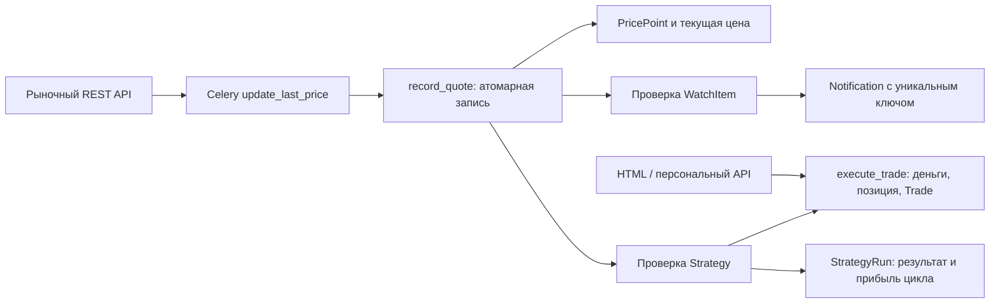

# Задание №4: новая функциональность

База модернизации — коммит `de3dc4f`, ветка `codex`. Документ задаёт новые
требования; описание исходной версии находится в `REQUIREMENTS.md`.

## Функциональные требования

1. **НФ-01. Изоляция данных.** Списки, уведомления, портфели, сделки и стратегии
   доступны только владельцу после входа. Обращение к чужому объекту даёт 404.
2. **НФ-02. Списки наблюдения.** Пользователь создаёт именованные списки,
   добавляет/удаляет акции и удаляет списки. Одна акция встречается в списке один раз.
3. **НФ-03. Целевые уровни.** Для записи списка можно задать положительную цену
   и условие «не ниже» или «не выше», изменить условие либо отключить его.
4. **НФ-04. Уведомление.** При обработке подходящей котировки появляется уведомление
   внутри приложения с акцией, условием, ценой и временем котировки.
5. **НФ-05. Отсутствие дублей.** Для одной конфигурации условия создаётся одно
   уведомление. Повтор котировки, повтор задачи и дальнейшие подходящие котировки
   не создают дублей. Изменение цены/направления условия начинает новую конфигурацию;
   сохранение тех же параметров не перевооружает уведомление.
6. **НФ-06. Чтение уведомлений.** Владелец видит историю и помечает сообщения прочитанными.
7. **НФ-07. Портфели.** Пользователь создаёт несколько портфелей с названием,
   валютой и неотрицательным начальным виртуальным балансом. Начальный капитал
   и валюта после создания неизменны; пополнений и конвертации валют нет.
8. **НФ-08. Виртуальная сделка.** Владелец покупает/продаёт положительное целое
   количество акций, указывая положительную цену либо используя текущую котировку.
   Валюта акции должна совпадать с валютой портфеля.
9. **НФ-09. Ограничения сделки.** Покупка не превышает доступные деньги,
   продажа — имеющееся количество. Короткие позиции, кредит и комиссии не моделируются.
   Отказ не изменяет баланс, позицию и журнал.
10. **НФ-10. Учёт позиции.** После покупки пересчитываются количество и средняя
    цена приобретения. При частичной продаже себестоимость списывается пропорционально;
    при полном закрытии остаток себестоимости равен нулю.
11. **НФ-11. Результат портфеля.** Отображаются деньги, позиции, рыночная стоимость,
    средняя цена, реализованный и нереализованный результат, общий результат и
    доходность относительно начального капитала. При отсутствии сопоставимой цены
    оценка неизвестна; отсутствующее значение не заменяется нулём.
12. **НФ-12. Журнал и повтор запроса.** Сделки неизменяемы, содержат время, сторону,
    количество, цену и источник. Повтор запроса с тем же UUID возвращает ту же сделку;
    использование UUID с другими параметрами отклоняется без повторного списания.
13. **НФ-13. История цен.** Каждая корректная котировка сохраняется с акцией,
    полной ценой и временем источника. Пара «акция, время» уникальна. При повторе
    с другой ценой первое сохранённое значение остаётся каноническим.
14. **НФ-14. Запоздавшие данные.** Старая котировка сохраняется в истории, но не
    заменяет текущую цену и не запускает уведомления/стратегии задним числом.
15. **НФ-15. Анализ периода.** Посетитель выбирает даты начала/окончания (UTC,
    обе даты включительно), видит наблюдения, первую/последнюю цену, абсолютное и
    процентное изменение. При нулевой первой цене процент не определён; при отсутствии
    данных показывается пустое состояние. Начало позже окончания отклоняется.
16. **НФ-16. Локальный график.** График строится по сохранённым данным без внешнего
    API; для читаемости показывается средняя цена каждого дня. Исходные наблюдения
    доступны отдельно и не заменяются агрегатами.
17. **НФ-17. Стратегия.** Владелец задаёт портфель, акцию, количество, порог покупки
    и порог продажи; покупка ниже продажи. Стратегия начинает с ожидания покупки.
18. **НФ-18. Автоматическое исполнение.** При цене не выше порога покупки стратегия
    покупает заданное количество, затем ждёт цену не ниже порога продажи и продаёт
    то же количество. Цикл повторяется на последующих котировках. Сделки виртуальные.
19. **НФ-19. Идемпотентность стратегии.** На одну пару «стратегия, котировка»
    допускается один результат исполнения. Повторная обработка не повторяет сделку.
20. **НФ-20. Невыполнимое условие.** Нехватка денег/акций либо несовпадение валют
    фиксируются в журнале стратегии без изменения её следующего шага. Следующая
    котировка позволяет повторить попытку. Неподходящая цена сделки не создаёт.
21. **НФ-21. Управление стратегией.** Владелец редактирует параметры, приостанавливает,
    возобновляет и удаляет стратегию. Портфель и акция существующей стратегии
    неизменны. Удаление не удаляет уже совершённые сделки и журнал исполнения.
22. **НФ-22. Эффективность.** Для стратегии отображаются выполненные/отклонённые
    операции, прибыль закрытых сделок и текущий следующий шаг. Полная оценка капитала
    доступна в соответствующем портфеле.
23. **НФ-23. Согласованность.** Запись котировки и её эффектов, сделки и балансы
    изменяются атомарно; параллельные задачи не создают дубли и отрицательные остатки.
24. **НФ-24. Интерфейсы.** Новые функции доступны через HTML и API. История цен
    публична; персональные API требуют входа. POST-формы и сессионные API защищены CSRF.
25. **НФ-25. Сохранение старых сценариев.** Каталог, внешний график, учётная запись,
    CRUD и импорт продолжают работать. Удаление акции, используемой финансовым журналом
    или стратегией, отклоняется понятным сообщением вместо потери данных или ошибки 500.

## Архитектура и изменения

Новое Django-приложение `investing` содержит списки, уведомления, портфели,
позиции, сделки, стратегии, журнал исполнения и историю котировок. Все персональные
выборки ограничены владельцем. Доменный слой сервисов общий для HTML, API и Celery.
Задача обновления передаёт котировки сервису записи истории; тот в одной транзакции
обновляет текущую цену, проверяет уровни и исполняет виртуальные стратегии.

Суммы хранятся как Decimal с 9 знаками; средняя себестоимость и результат частичной
продажи округляются до этой точности по правилу HALF_UP. Для PostgreSQL применяются
блокировки строк; SQLite использует IMMEDIATE-транзакции. Запись повторных событий
защищена уникальными ограничениями БД. История изначально пуста и накапливается
после включения; старые свечи внешнего графика автоматически не импортируются.

## Реализация и модель данных

| Модель | Основные данные и связи |
| --- | --- |
| `Watchlist` | Владелец, имя; уникальность имени внутри владельца |
| `WatchItem` | Список, акция, уровень и направление, версия условия, время срабатывания |
| `Notification` | Владелец, уникальный ключ события, снимок сообщения/цены/времени, отметка чтения; сохраняется после удаления записи списка |
| `Portfolio` | Владелец, валюта, начальный и доступный капитал |
| `Position` | Уникальная пара портфель–акция, количество и оставшаяся себестоимость |
| `Trade` | Неизменяемая операция, цена/сумма, результат продажи, UUID запроса, источник; ссылка на акцию защищена от удаления |
| `PricePoint` | Акция, время источника, цена и снимок валюты; уникальность акции и времени |
| `Strategy` | Портфель, акция, пороги, количество покупки, активность, следующий шаг, количество/стоимость открытого цикла |
| `StrategyRun` | Портфель, снимок имени стратегии, котировка, результат исполнения, причина отказа и прибыль завершённого цикла; сохраняется после удаления правила |

В `Share` добавлено `market_updated_at` — время принятой котировки отдельно от
обычного сохранения модели. Новые миграции: `dashboard/0009` и `investing/0001`.
Старые цены не превращаются в выдуманные исторические наблюдения.



Сетевой запрос выполняется до транзакции. Задача выбирает акции материализованными
пакетами по 100 и закрывает курсор чтения перед записью. Это исключает удержание
SQLite-курсора во время ожидания сети или конкурирующего списания средств.

Доменная логика общая для интерфейсов:
[учёт сделок](investing/services/trading.py),
[уведомления](investing/services/monitoring.py),
[стратегии](investing/services/strategies.py),
[приём котировки](investing/services/prices.py),
[анализ истории](investing/services/history.py).
Владение и фильтрация персональных данных проверяются в
[HTML-представлениях](investing/views.py) и [API](investing/api.py).

PostgreSQL блокирует акцию, затем портфель; стратегии обрабатываются в одинаковом
порядке портфелей. SQLite не поддерживает блокировку строки `SELECT FOR UPDATE`,
поэтому используются короткие IMMEDIATE-транзакции с тайм-аутом ожидания 20 секунд.
См. [документацию Django о SQLite](https://docs.djangoproject.com/en/5.2/ref/databases/#transactions-behavior)
и [блокировках QuerySet](https://docs.djangoproject.com/en/5.2/ref/models/querysets/#select-for-update).

### Правила расчётов и исполнения

- Покупка: `cash -= quantity × price`, `cost_basis += quantity × price`.
  Средняя цена позиции равна `cost_basis / quantity`.
- Частичная продажа списывает `cost_basis × sold / held` с округлением до 9 знаков;
  последняя продажа списывает весь остаток. Реализованный результат — выручка минус
  списанная себестоимость.
- Стоимость портфеля — деньги плюс стоимость открытых позиций. Общий результат —
  стоимость минус начальный капитал; доходность — этот результат / начальный капитал
  × 100. При нулевом капитале процент не определён.
- Неполная рыночная оценка обозначается неизвестной. Валюты не конвертируются.
  При истории с разными валютами график строит отдельные линии, общее изменение
  не рассчитывается. Дневное среднее служит графику; изменение периода считается
  по первой и последней исходным котировкам.
- Стратегия использует общий баланс и позиции портфеля. Из подходящих правил одного
  портфеля первыми обрабатываются более ранние. Изменение количества влияет на
  следующую покупку; уже открытый цикл продаёт своё исходное количество.
- Результат цикла стратегии — её выручка от продажи минус стоимость её покупки.
  Реализованный результат портфеля использует общую среднюю себестоимость;
  при смешивании ручных и автоматических сделок эти показатели могут различаться.
- Ручная продажа может уменьшить доступные стратегии акции; её последующая продажа
  тогда отклоняется с записью причины. Удаление правила не ликвидирует позиции.
- Уведомления показываются внутри приложения. Email, мессенджеры и реальные
  брокерские поручения не используются.

## Маршруты и использование

После входа откройте `/workspace/`. Создайте список наблюдения, добавьте акцию и
ценовой уровень. Создайте портфель с валютой акции и начальным капиталом; кнопка
«Совершить виртуальную сделку» позволяет проверить покупку и продажу. На той же
странице личного кабинета создаются и редактируются стратегии. Снятие флага
«Активна» приостанавливает исполнение. Уведомления находятся в `/notifications/`.

Ссылка «Накопленная история цен» из карточки ведёт на `/shares/<id>/history/`.
Период задаётся датами `start` и `end`. Для накопления настоящих котировок нужен
настроенный токен и работающие Worker/Beat; личный кабинет и ручные виртуальные
операции доступны без внешнего API.

| API | Операции |
| --- | --- |
| `/api/v1/watchlists/`, `/<id>/` | Список, создание, чтение, изменение имени, удаление |
| `/api/v1/watch-items/`, `/<id>/` | CRUD условий; фильтр `?watchlist=<id>` |
| `/api/v1/notifications/`, `/<id>/read/` | Чтение и POST отметки прочтения |
| `/api/v1/portfolios/`, `/<id>/` | Создание, чтение, изменение имени; денежные остатки не редактируются |
| `/api/v1/portfolios/<id>/trades/` | GET журнала, POST сделки с `share`, `side`, `quantity`, `request_id`, необязательным `price` |
| `/api/v1/portfolios/<id>/strategy-runs/` | История исполнения, включая удалённые правила |
| `/api/v1/strategies/`, `/<id>/`, `/<id>/runs/` | CRUD правил, приостановка через `PATCH active=false`, журнал |
| `/api/v1/shares/<id>/history/?start=2026-11-01&end=2026-11-30` | Публичная история с пагинацией, итогами и дневным графиком |

Новые денежные поля API возвращаются строками для сохранения десятичной точности.
Существующий `/shares/` продолжает возвращать цену числом. Для ручного повтора
сделки используйте тот же UUID `request_id`: первый запрос даёт 201, повтор — 200
с тем же идентификатором сделки, конфликт параметров — 409. Прочие нарушения
бизнес-правил дают 400, неподдерживаемые операции — 405. Поддерживаемая операция
над чужим персональным объектом даёт 404; списки содержат только свои записи.

## Результаты проверки

Проверено 1 ноября 2026 года в отдельной копии ветки `codex`. Модернизация
задания №3 остаётся отдельным коммитом `de3dc4f`; новые функции добавляются поверх неё.

| Проверка | Результат |
| --- | --- |
| Полный набор на PostgreSQL 17.11 | **104 теста, OK**, включая четыре параллельных сценария |
| Полный набор на SQLite | **100 тестов успешно**, четыре проверки PostgreSQL-блокировок пропущены по возможностям backend |
| Покрытие `config,dashboard,user,investing`, без тестов и миграций | **95%** строк |
| Сквозной сценарий с настоящими HTTP, Worker, Beat и Redis 8.10.3, SQLite | **41 проверка, OK** |
| Тот же сценарий, PostgreSQL | **41 проверка, OK** |
| `check`, `makemigrations --check --dry-run`, Black, isort, `pip check` | Успешно |

Сквозной сценарий использует локальный **синтетический рыночный HTTP-сервис**.
Проверяется реальная цепочка транспорта, очереди и транзакций; настоящие токены,
реальные котировки и брокерские операции не используются. Дополнительные
зависимости относительно задания №3 не потребовались.

| Требования | Основные проверки |
| --- | --- |
| НФ-01, 24: владение, HTML/API, CSRF | [AccessTests](investing/tests/test_access.py), два пользователя в [HTTP-сценарии](scripts/verify_features.py) |
| НФ-02–06: списки, уровни, уведомления | [MonitoringTests](investing/tests/test_monitoring.py): повтор, пересечение уровня, неизменённое/изменённое условие, удаление списка |
| НФ-07–12: портфели, позиции, журнал | [TradingTests](investing/tests/test_trading.py): средняя цена, частичное/полное закрытие, нехватка средств/акций, валюта, повтор UUID, отсутствие котировки |
| НФ-13–16: история и анализ | [HistoryTests](investing/tests/test_history.py): даты включительно, дневные средние, нулевая база, разные валюты, пустой период, локальный график и API без сети |
| НФ-17–22: стратегии и эффективность | [StrategyTests](investing/tests/test_strategies.py): цикл, повтор котировки, нехватка средств, пауза, изменение количества, ручное вмешательство, удаление правила |
| НФ-23: атомарность и конкуренция | [ConcurrencyTests](investing/tests/test_concurrency.py): конкурирующие покупки, продажи, одинаковый UUID, обработка одного наблюдения; инъекция сбоя откатывает историю и уведомление |
| НФ-25: регрессии | Все прежние тесты; HTML/API возвращают 409 при удалении акции с финансовыми ссылками; переход на приватную страницу после входа защищён от внешнего перенаправления |

Контрольный пример из тестов: капитал 1000, покупки 2 × 100 и 2 × 200 дают
4 акции со средней ценой 150 и деньги 400. Продажа одной за 200 оставляет
3 акции, себестоимость 450, деньги 600 и реализованную прибыль 50. При котировке
180 стоимость портфеля составляет 1140, общий результат 140 (14%), нереализованный
результат 90. Полное закрытие дробной себестоимости не оставляет остатка.

Команды повторения после установки dev-зависимостей:

```sh
python manage.py migrate
python manage.py test
python scripts/verify_runtime.py --features
python scripts/verify_runtime.py --features --broker redis://127.0.0.1:6379/0
# POSTGRES_* задаются в окружении; требуется право создать временную БД:
python scripts/verify_runtime.py --features --postgres --broker redis://127.0.0.1:6379/0
```

Сквозная проверка создаёт временную БД и отдельную очередь, затем завершает свои
процессы и удаляет тестовые данные. Основной сервер после применения миграций
запущен на <http://127.0.0.1:8011/>; личный кабинет — `/workspace/`.
